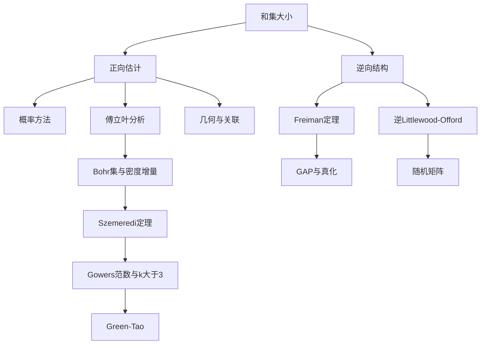

# Additive Combinatorics 点化学习系统

## 这本书在讲什么

加性组合学问一个很朴素的问题：一堆整数（或群里的元素）在加法下能长出多少种结果。如果长得很少，说明这堆数有结构；如果长得很多，说明它接近随机。全书就是在把"很少"和"很多"这两种直觉变成定理，并且用四套工具反复往返：概率、傅立叶、几何、代数。

Tao 和 Vu 的写法是"工具驱动"的：先给一套工具，再用它打一批问题，最后把工具升级。读这本书最容易犯的错是按章顺序硬啃，结果每一章都觉得懂，合起来不知道在干什么。所以这份手册按"问题—工具—结构"三条线重排，先让你知道每一步是为了解决什么。

## 全书心智模型

看这张图要知道一件事：**左边是"有多大"，右边是"长什么样"，中间的工具是双向的**。同一个傅立叶系数，既能把和集估大，也能在它不够大时指出结构在哪里。

## 学习路径（推荐顺序）

| 步骤 | 章节 | 主题 | 前置 | 检查点 |
|---|---|---|---|---|
| 01 | ch00 | 建立坐标：加性集、和集、倍增常数 | 无 | 能说出 σ=1、σ≈2、σ≈n/2 各对应什么 |
| 02 | ch01 | 概率工具箱 | ch00 | 能用一阶矩独立证明一个存在性结论 |
| 03 | ch02 | 和集估计与能量 | ch01 | 能写出能量下界，说明 BSG 为什么必须损失子集 |
| 04 | ch03 | GAP 与凸体 | ch02 | 能算低秩 GAP 的体积并判断真伪 |
| 05 | ch04 | 换到频率空间 | ch02 | 能用卷积定理推一个和集估计 |
| 06 | ch05 | 小倍增的结构 | ch03、ch04 | 能复述 Freiman 定理，说清有挠时的处理 |
| 07 | ch06 | 图论工具箱 | ch02 | 能用 Turán 定理估一个无和集 |
| 08 | ch07 | Littlewood–Offord | ch04 | 能区分正问题与逆问题 |
| 09 | ch08 | 关联几何 | ch02 | 能说清 S-T 定理的 2/3 从哪来 |
| 10 | ch09 | 有限域上的多项式方法 | ch02 | 能写出零点定理的完整条件 |
| 11 | ch10 | 密度增量：k=3 | ch04、ch05 | 能讲清四步迭代为什么终止 |
| 12 | ch11 | 高阶均匀性：k>3 | ch10 | 能说清 k=4 为什么不能用线性傅立叶 |
| 13 | ch12 | 和集的结构增益 | ch02、ch10 | 能对比本章与 Szemerédi 的长度差别 |

**如果你只想读一部分**：做数论/组合的，走 01→02→03→05→06→11→12；做几何/关联的，走 01→03→04→09→10；做随机矩阵/概率的，走 01→02→05→08。

## 章节索引

- 第 0 章 导论（★☆☆）→ `chapters/ch00-导论.md`
- 第 1 章 概率方法（★★☆）→ `chapters/ch01-概率方法.md`
- 第 2 章 和集估计（★★★）→ `chapters/ch02-和集估计.md`
- 第 3 章 加性几何（★★★）→ `chapters/ch03-加性几何.md`
- 第 4 章 傅立叶分析方法（★★★）→ `chapters/ch04-傅立叶分析.md`
- 第 5 章 逆和集定理（★★★★）→ `chapters/ch05-逆和集定理.md`
- 第 6 章 图论方法（★★★）→ `chapters/ch06-图论方法.md`
- 第 7 章 Littlewood–Offord 问题（★★★）→ `chapters/ch07-Littlewood-Offord.md`
- 第 8 章 关联几何（★★★）→ `chapters/ch08-关联几何.md`
- 第 9 章 代数方法（★★★★）→ `chapters/ch09-代数方法.md`
- 第 10 章 k=3 的 Szemerédi 定理（★★★★）→ `chapters/ch10-Szemeredi-k3.md`
- 第 11 章 k>3 与 Gowers 范数（★★★★★）→ `chapters/ch11-Gowers范数.md`
- 第 12 章 和集中的长等差数列（★★★）→ `chapters/ch12-和集中的长等差数列.md`

## 前置知识（零基础缺口补讲）

| 缺口 | 补讲位置 | 学完标志 |
|---|---|---|
| 群、子群、陪集、同态 | ch00 概念 1–3；ch03 概念 2 | 能解释为什么 ℤ/Nℤ 和 ℤ 上同一个集合的和集不同 |
| 期望、方差、独立、Markov | ch01 概念 1–3 | 能独立写出"期望小于 1 则存在零样本"的论证 |
| 复指数、内积、正交基 | ch04 概念 1–2 | 能解释 e^{2πirx/N} 为什么是特征 |
| 图的基本概念（度、独立集、匹配） | ch06 概念 1–3 | 能把一个和集问题画成二分图 |
| 有限域、多项式零点 | ch09 概念 1 | 能说明为什么零点定理要求"域"而不是"环" |
| 凸集、体积、格 | ch03 概念 3–4 | 能叙述 Minkowski 格点定理的条件 |

这些缺口不必先补完再读，按路径在对应章节前补即可。每章开头都写了前置，卡住时回查这张表。

## 怎么用这套东西

- **先读总入口 `index.html`**：左侧按章节走，学完一章做该章测验，错题看解析。
- **抽认卡**放在手机里，通勤时刷。正面是问题，别提前看背面。
- **速查表**在做题时开着，查不等式和常数。
- **模式库**在你自己动手证东西时看，八套套路对应八类问题。
- **原书**当词典用：本手册告诉你"这个定理在干什么"，具体证明回原书查页码。

## 术语 / 模式 / 速查入口

- 术语表：`glossary.md`（52 条，按章节标注首次出现）
- 模式库：`patterns.md`（八套证明框架 + 决策规则 + 反模式）
- 速查表：`cheatsheet.md`（记号、不等式、常数、路线）
- 测验：`quiz.md`（45 题，含 6 道跨章综合）
- 抽认卡：`flashcards.md`（52 张）
- 概念页：`concepts/`（14 篇，跨章概念）
