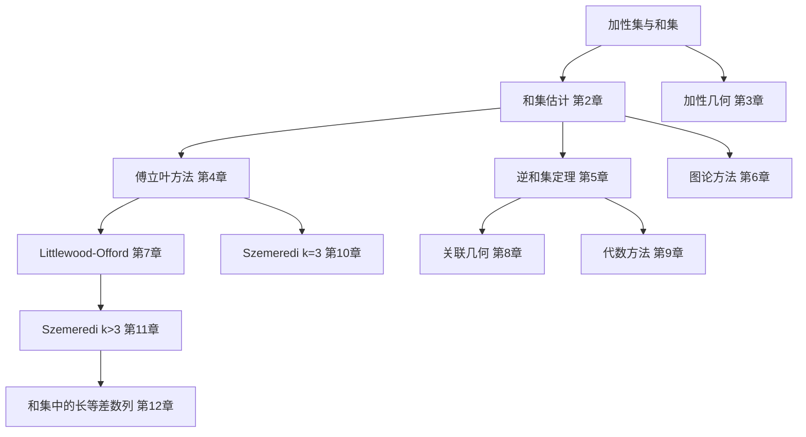

# 第 0 章：这门学科在做什么

- **难度**：★☆☆ | **预估学时**：2 小时 | **前置**：微积分、线性代数、概率论的基本概念

## 学习目标

学完本章，你能：

- 说清"加性集"和"和集"这两个词在本书里指什么
- 用一两句话解释为什么"集合有多少加性结构"可以用 |A+A| 来衡量
- 看懂全书十二章的组织逻辑，知道哪几章是主干、哪几章是专用工具

## 一句话核心

加性组合学研究的是"一个集合在加法下有多大的结构"，衡量方式是看 A+A 比 A 大多少；结构强就往等差数列方向走，结构弱就接近随机。

## 零基础讲解

### 概念 1：加性集（additive set）

本书开头就规定：一个加性集是一对 (A, Z)，其中 Z 是一个交换群，A 是 Z 的有限非空子集。所有讨论都相对这个"环境群"进行。

**为什么一定要带上 Z？** 因为"和"这个运算要在某个群里才有意义。同样是 {1, 2, 3}，放在整数群里，1+2=3；放在模 5 的群里，2+3=0，结构完全不同。

**例子**：A = {1,2,3} ⊂ ℤ，则 A+A = {2,3,4,5,6}，五个元素。A = {0,1,2} ⊂ ℤ/3ℤ，则 A+A = {0,1,2}，还是三个元素。同一个大小的集合，第二个的加性结构明显更强。

### 概念 2：和集与差集

A+B = {a+b : a∈A, b∈B}，A−B = {a−b : a∈A, b∈B}。这两个是最基本的观察对象。

直觉上，两个"随机"的集合相加，结果会铺开得很大，接近 |A||B| 的量级；两个"有结构"的集合（比如等差数列）相加，结果只比原来大一点。所以 |A+A| 与 |A| 的比值，可以当作结构强弱的温度计。

### 概念 3：倍增常数

σ[A] := |A+A| / |A|。

- σ[A] = 1 只有一种情况：A 是子群（或子群的陪集）。
- σ[A] 很小（比如小于 2、小于 3）时，A 的结构可以被完全刻画，这是第 5 章的内容。
- σ[A] 接近 |A| 时，A 几乎是随机的，加性组合学的强定理基本管不到。

这条例题贯穿全书：**结构越强，σ 越小；σ 越小，集合越像等差数列或者子群。**

### 概念 4：两种问法，正问题和反问题

正问题（第 2 章）：已知 A、B 的某些信息，能推出 |A+B| 至少多大、最多多大？

反问题（第 5 章）：已知 |A+A| 很小，能反推出 A 长什么样？

这两种问法在整本书里交替出现。第 7 章的 Littlewood–Offord 问题也是同样的正反结构：一边问"子集和最多能集中到什么程度"，一边问"如果集中了，步长向量必须长什么样"。

## 图示

## 类比与实例

**类比**：把集合想成一群人，加法想成"两人握手"。

- 如果这群人来自同一个家族，彼此都认识，握手组合的种类很少——这就是子群或者等差数列，σ 小。
- 如果这群人是随机抽的陌生人，握手组合几乎两两不同——σ 大。

**注意类比的失效边界**：现实中的"认识"不满足结合律也不满足交换律，而群运算满足。所以这个类比只能帮你记住"结构 = 组合数量少"，不能用来推导定理。

**实例**：取 A = {0,1,...,n−1} ⊂ ℤ。A+A = {0,1,...,2n−2}，大小 2n−1，σ[A] = (2n−1)/n ≈ 2。这就是最标准的"有结构"：一个等差数列，加倍后长度只翻了一倍。

再取 B = {0,1,2,4,8,...,2^{n−1}}（等比数列）。B+B 里的元素是 2^i+2^j（i≤j），互不相同的有 n(n+1)/2 个，σ[B] ≈ n/2，几乎最大。等比数列在加法下毫无结构——这是最常用的反例。

## 常见误解

- 别以为 σ[A] 小就一定是等差数列。σ[A] < 3 时确实能刻画，但刻画出来的是"子群加小扰动"或者"低秩广义等差数列"，形状比等差数列宽得多。
- 别以为 |A+A| 只能靠"数一遍"来算。对 n 很大的集合，直接枚举 A+A 是 O(n²)，定理的价值就在于不解方程也能给出上下界。
- 别以为环境群不重要。同一个 A 放在 ℤ 和 ℤ/pℤ 里，σ 可以差很远；本书很多定理都要求"无挠"（torsion-free）或"特征大"。

## 自测题（答案）

1. A = {1,2,3} ⊂ ℤ，|A+A| 是多少？（答案：5；解析：2 到 6 共五个值，注意 1+3=2+2 这类重复会合并。）
2. 为什么 σ[A] = 1 意味着 A 是子群或陪集？（答案：因为 |A+A| = |A| 表示 A+A 与 A 同大小，而 A+A 包含 A+a₀ 的平移，只能是整个集合对加法封闭；解析：取 a₀∈A，A+a₀ ⊂ A+A 且大小相同，故 A+A = A+a₀，推出 A 对加法封闭。）
3. 等比数列为什么是"加法下无结构"的典型？（答案：指数不同的二进制和几乎不重复，|B+B| 接近 n²/2，σ 接近 n/2；解析：2^i + 2^j 的二进制表示唯一确定 i、j。）

## 复习锚点

- 加性集 = 集合 + 环境群，两个都要说。
- σ[A] = |A+A|/|A|，是全书的结构温度计。
- 正问题给界，反问题给形状，两条线交错推进。
