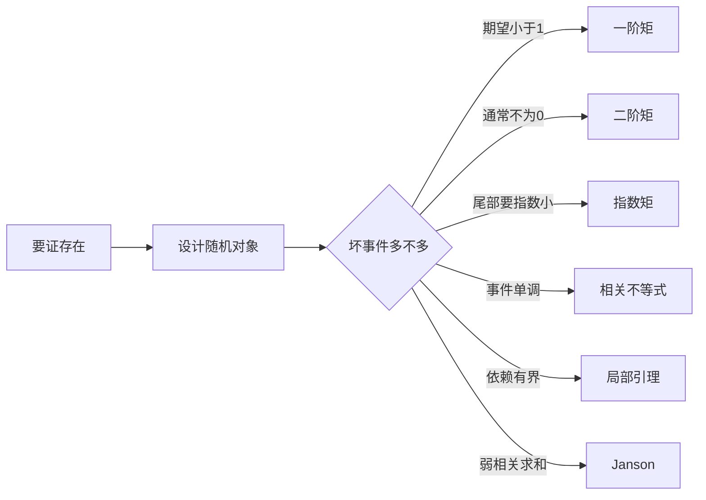

# 第 1 章：概率方法

- **难度**：★★☆ | **预估学时**：8 小时 | **前置**：第 0 章；概率论的期望、方差、独立

## 学习目标

学完本章，你能：

- 用一阶矩、二阶矩、指数矩三种手段证明"满足某性质的对象存在"
- 说出 FKG、BK、Harris 三个相关不等式的适用条件，知道它们为什么要求"单调事件"
- 用 Lovász 局部引理处理有依赖的坏事件，用 Janson 不等式处理弱相关的情形
- 解释为什么"随机构造"能给出确定性结论

## 一句话核心

想证明存在一个集合 B 具有性质 P，只要设计一个随机集合，证明它满足 P 的概率大于零；四种矩方法分别对应四种"概率不为零"的估计方式。

## 零基础讲解

### 概念 1：一阶矩方法

若 X 是非负整数值随机变量，则 P(X > 0) ≤ E X。反过来，如果 E X < 1，就必然存在一个样本使 X = 0。这是最简单的"存在性"工具。

**典型用法**：数"坏对象"的期望个数。如果坏对象的期望个数小于 1，就存在一个对象不是坏的。

**例子（无和集）**：从 {1,...,n} 里随机选一个子集，每个元素以概率 p 独立入选。计算"含 x+y=z"的三元组期望个数，取 p 使期望小于 1，就能找到一个大小约 n/3 的无和集。这就是 Erdős 的经典结论：最大无和子集至少有 ⌈n/3⌉ 个元素。

### 概念 2：二阶矩方法

只有期望不够时，看方差。切比雪夫不等式给出 P(|X − EX| ≥ t) ≤ Var(X)/t²。常用形式是

P(X > 0) ≥ (EX)² / E(X²)。

这个式子比一阶矩强的地方在于：它要求随机变量"通常不为零"，而不只是"平均不为零"。

**例子**：随机图里的三角形个数、随机集合里的表示次数，都适合先用期望判断量级，再用二阶矩确认它不集中在零附近。

### 概念 3：指数矩方法与 Chernoff 界

对独立的 0-1 变量之和 S，用 Markov 不等式作用在 e^{tS} 上，再对 t 优化，得到

P(S ≥ (1+δ)μ) ≤ exp(−μδ²/3)，P(S ≤ (1−δ)μ) ≤ exp(−μδ²/2)。

关键在"对 t 优化"这个动作：直接对 S 用 Markov 只能得到多项式型的界，套上指数函数再优化就能得到指数型衰减。这是后面大量证明里估计尾部概率的标准动作。

### 概念 4：相关不等式

FKG、BK、Harris 说的是同一件事的不同版本：**如果事件是单调增的，那么它们正相关**。

比如"随机子集包含某个固定元素"是单调增事件，两个这样的事件同时发生的概率，不小于各自概率的乘积。这样就能把复杂的联合概率拆成乘积来估算。

用的时候要注意两点：事件必须单调（增加元素不会让事件从真变假），测度必须是乘积测度。少一个条件，不等式就不成立。

### 概念 5：Lovász 局部引理与 Janson 不等式

局部引理处理的是"坏事件之间有依赖，但每个坏事件只和少数几个坏事件相关"的情形：若每个坏事件概率不超过 p，且每个坏事件最多与 d 个其他坏事件相关，当 e·p·(d+1) ≤ 1 时，所有坏事件都不发生的概率为正。

Janson 不等式是它的"求和版本"，给出坏事件至少发生一个的概率上界，适用于弱相关的情形。

两者的差别：局部引理要"依赖度有界"，Janson 要"依赖结构可以用图上的边来量化"。做题时先看依赖图的度，度小用 LLL，度大但边少用 Janson。

### 概念 6：多项式集中

随机变量是低次多项式时（比如随机图的边数、随机集合的表示函数），可以用"改变一个变量最多改变多少"来度量集中程度。这类结果在本书里用来处理不能用独立性和给出的量。

## 图示

## 类比与实例

**类比**：想证明"会场里存在一个不说话的人"，不必挨个去问。可以随机点一个人，算他说话的概率；如果平均说话人数小于 1，就必然有沉默的人。二阶矩相当于再确认"大多数人确实在说话"，否则平均数小于 1 也可能只是少数人说了很多话。

**失效边界**：这个类比只在"人数有限、概率可算"时成立。连续分布或者无限集合上，需要先做截断。

**实例（薄基）**：自然数的一个基是指 A+A 覆盖所有足够大的整数。用概率方法可以构造出"薄"的基：让 A 在 [1,N] 里随机选取，密度约 √(log N / N)，则几乎每个数都有表示，同时 |A| 远小于 N。这个构造的意义是：基可以很稀疏，稀疏到 |A| ≈ N^{1/2} 量级，而不是 N。

## 常见误解

- 别以为概率方法给出了算法。它只证明存在，不给出构造；很多情况下确定性构造至今未知。
- 别以为"期望小于 1"就能推出"一个坏对象都没有"。它只能推出"存在一个对象没有坏"，这两个结论方向不同。
- 别以为相关不等式对任意事件都成立。去掉单调性，FKG 立刻失效，反例很容易构造。
- 别以为 Chernoff 界只对 0-1 变量有效。它有多种推广形式，但使用时必须核对独立性或负相关性条件。

## 自测题（答案）

1. 若 E X = 0.9 且 X 取非负整数，能推出什么？（答案：存在样本使 X=0；解析：若处处 X≥1，则 E X≥1，矛盾。）
2. 为什么二阶矩方法比一阶矩"更强"？（答案：它估计的是 P(X>0) 的下界，而一阶矩给的是上界；解析：两者方向不同，二阶矩用方差排除了"集中在零附近"的可能。）
3. 局部引理中 e·p·(d+1) ≤ 1 这个条件在控制什么？（答案：控制依赖图的度数与坏事件概率的乘积；解析：每条依赖边贡献一份概率放大，度越大要求 p 越小。）

## 复习锚点

- 四种矩：一阶给存在，二阶给不集中，指数矩给指数尾，相关不等式给联合概率。
- LLL 看"度"，Janson 看"边"。
- 随机构造只证存在，不构造算法。
