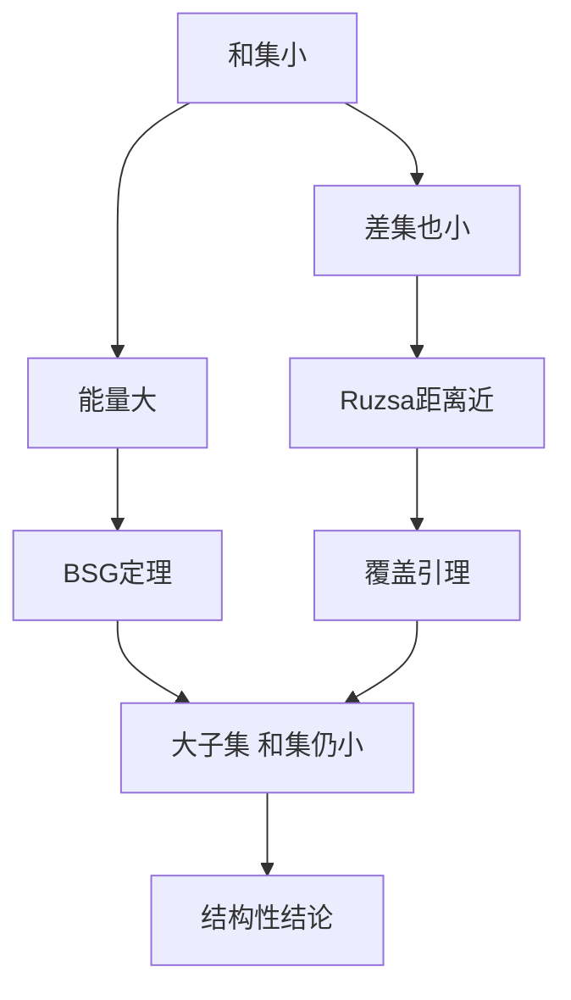

# 第 2 章：和集估计

- **难度**：★★★ | **预估学时**：12 小时 | **前置**：第 0、1 章

## 学习目标

学完本章，你能：

- 用 Ruzsa 距离和加性能量这两个量描述和集的大小
- 说清覆盖引理在做什么，为什么它是"局部化"的工具
- 叙述 BSG 定理的结论，知道它把"能量大"翻译成"存在大子集使和集小"
- 用多项式方法证明一个基本的和积估计

## 一句话核心

|A+B| 小不是一个孤立事实，它会牵动 |A−B|、能量、子集结构；Ruzsa 距离把这种牵动整理成了一个度量空间，BSG 定理是其中最锋利的转换器。

## 零基础讲解

### 概念 1：和集的基本界

最平凡的上界是 |A+B| ≤ |A||B|。最平凡的下界是 |A+B| ≥ |A| + |B| − 1（在整数群里）。

真正有用的是"反向"：如果 |A+B| 明显小于 |A||B|，说明 A、B 之间有加法关系。这种关系可以传递：|A+B| 小，往往意味着 |A−B| 也小。

### 概念 2：Ruzsa 距离

定义 d(A,B) = log( |A−B| / √(|A||B|) )。

**为什么用差集而不是和集？** 因为差集有对称性：A−B 与 B−A 大小相同，而 A+B 与 B+A 虽然也相同，但差集在群里有更好的代数性质（A−A 包含 0，是"对称"的）。

这个 d 满足三角不等式：

d(A,C) ≤ d(A,B) + d(B,C)。

于是所有有限加性集构成一个度量空间。很多证明的思路就是"先在 d 意义下靠近，再用覆盖引理把靠近翻译成集合层面的包含"。

**例子**：A = [0,n−1]，B = [0,m−1]，则 |A−B| = n+m−1，d ≈ ½log(n/m) + 常数。两个长度相近的区间，距离接近 0。

### 概念 3：加性能量

E(A,B) = #{ (a,b,a',b') : a+b = a'+b' }。

它数的是"和相同的四元组"有多少。E 大，说明 A+B 里每个元素有很多种表示，也就是加法关系密集。

几个基本事实：

- E(A,B) ≥ |A|²|B|² / |A+B|（由柯西不等式）。
- E(A,A) 与 |A+A| 的关系是"能量大 ⟺ 和集小"的一条定量版本。
- 能量的加法结构可以用傅立叶系数表示：E(A,A) = Σ |Â(ξ)|⁴（第 4 章会用）。

### 概念 4：覆盖引理

Ruzsa 覆盖引理：若 |A+B| ≤ K|B|，则存在 A' ⊂ A，|A'| ≤ K，使得 A ⊂ A' + B − B（差集的平移覆盖）。

它的作用是把"和集小"变成"整个 A 可以被少数几个 B−B 的平移盖住"。这是一个局部化动作：原来要处理整个 A，现在只要处理一个大小受控的"骨架" A'。

Green–Ruzsa 覆盖引理处理的是"近似子群"的情形，Chang 覆盖引理处理的是傅立叶谱的情形（第 5 章会用到）。

### 概念 5：BSG 定理

Balog–Szemerédi–Gowers 定理的粗略表述：

如果加性能量 E(A,B) 接近最大值（即 |A+B| 远小于 |A||B|），那么存在 A' ⊂ A、B' ⊂ B，两者都只损失一个常数因子的大小，而 |A'+B'| 只比 |B'| 大常数倍。

一句话：**能量大 ⟹ 存在大子集，其和集很小**。

这条定理是整本书使用频率最高的工具之一。它的证明有两个版本：一个用图论（第 6 章），一个用依赖随机变量的方法。

### 概念 6：对称集与不平衡部分和集

A 是对称集指 A = −A（在群里）。对称集的和集、差集行为比一般集合规整。书里用"部分和集"来衡量 A 在某个方向上的投影有多大，从而把一般集合的问题归约到对称情形。

### 概念 7：非交换版本

前面的定义可以搬到非交换群上，代价是 A+B 与 B+A 不再相同，所有不等式都要写成双边形式。第 2.7 节给出了一批这样的结果。

### 概念 8：初等和积估计

在实数域上，考虑 A+A 与 A·A 的大小。直观上，一个集合不可能在加法和乘法下同时都很小：要么加法有结构（A 接近等差数列），要么乘法有结构（A 接近等比数列）。初等版本用 |A+A| 与 |A·A| 的下界给出

max(|A+A|, |A·A|) ≥ c |A|^{1+ε}。

证明手法是"把乘法通过对数变成加法"再套用和集估计，或者用整除性做组合计数。

## 图示

## 类比与实例

**类比**：把 A 想成一栋楼的住户，B 想成快递柜。|A+B| 是"住户能取到的快递位置"数量。如果这个数量很少，说明快递柜的位置和住户的住址高度重合——于是住户们其实挤在少数几栋楼里。覆盖引理就是在说"少数几栋楼"这件事，BSG 则进一步说"存在一批住户和一批柜子，彼此贴得很近"。

**失效边界**：这个类比假设了"位置"可以相加，现实里地址不是向量，套不上群结构。

**实例**：取 A = B = {0,1,2,3} ⊂ ℤ。A+A = {0,...,6}，|A+A| = 7，σ = 1.75。能量 E(A,A)：每个和 s 的表示数依次是 1,2,3,4,3,2,1，平方和 = 1+4+9+16+9+4+1 = 44。而 |A|²|B|²/|A+B| = 256/7 ≈ 36.6，44 比它大，符合理论下界。

## 常见误解

- 别以为 Ruzsa 距离是普通距离。它是"对数尺度"上的距离，d=0 只说明 |A−B| = √(|A||B|)，不说明 A=B。
- 别以为能量大就一定有强结构。能量大只保证"存在大子集"结构好，子集之外的少数元素可以很乱。
- 别以为覆盖引理给出了 A 的完整结构。它给的是"覆盖"，覆盖用的骨架 A' 本身可能仍然很复杂。
- 别以为和积估计对任意环都成立。实数域用序结构，有限域要用多项式方法（第 9 章），两者的证明路线完全不同。

## 自测题（答案）

1. 若 |A|=|B|=n 且 |A+B|=n，能推出什么？（答案：A+B 与 B 同大小，存在 A' 大小为常数使 A 被 B−B 的平移覆盖；解析：这是 σ 极小的情形，直接用 Ruzsa 覆盖引理，K=1。）
2. Ruzsa 距离为什么用差集定义而不是和集？（答案：差集满足 A−A 含 0、A−B 与 B−A 同大小，能形成度量；解析：和集在非交换群里失去对称性，三角不等式也不好证。）
3. BSG 定理的结论里，为什么只能保证"子集"而不是整个 A？（答案：少数异常元素可能破坏和集大小，取子集才能把损失控制在常数因子；解析：定理的证明通过随机抽样或图匹配挑出"规矩"的部分。）

## 复习锚点

- |A+B| 小会牵动 |A−B|，用 Ruzsa 距离统一度量。
- 能量 E 数的是"同一和的多种表示"，大能量 ⟹ 大子集结构好（BSG）。
- 覆盖引理是局部化工具，骨架大小受 K 控制。
- 和积不可能同时小，这是加法结构与乘法结构的互斥。
