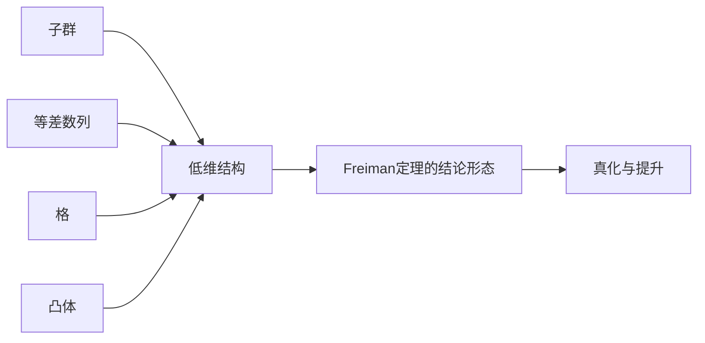

# 第 3 章：加性几何

- **难度**：★★★ | **预估学时**：8 小时 | **前置**：第 2 章；线性代数；一点凸几何

## 学习目标

学完本章，你能：

- 写出广义等差数列的定义，算出它的体积上界
- 说清"真"等差数列与"非真"的区别，知道非真会带来什么麻烦
- 用 Brunn–Minkowski 不等式解释"凸体相加会变大但不会大太多"
- 说明 Minkowski 格点定理和 Blichfeldt 引理在做什么

## 一句话核心

等差数列、格、凸体、有限子群看起来是四类对象，但在加性结构上它们是同一件事的不同外观：都可以用"维数、体积、生成元"三个参数来描述。

## 零基础讲解

### 概念 1：广义等差数列

一维的等差数列是 a, a+v, a+2v, ...。多维版本是

P = a + [0,N₁]·v₁ + [0,N₂]·v₂ + ... + [0,N_d]·v_d，

其中 a 是起点，v_i 是方向，N_i 是每个方向的长度。这样的集合叫秩为 d 的广义等差数列（GAP）。

它的元素个数最多是 ∏(N_i+1)。如果实际个数就等于这个乘积，称它是**真**的（proper）；否则叫非真。

**为什么在乎真不真？** 非真的 GAP 里，不同的系数组合会撞到同一个元素，集合比"看起来"小。很多定理（比如 Freiman 定理的结论）需要真 GAP，或者需要"低秩"来控制这种塌缩。

**例子**：P = [0,2]·1 + [0,2]·2 = {0,1,2,4,5,6,8,9,10}，共 9 个，等于 3×3，是真 GAP。若取 v₂ = 3，得到 {0,1,2,3,4,5,6,7,8}，也只有 9 个，仍是真；但取 v₂ = 1，就只有 {0,1,2,3}，缩成 4 个，非真。

### 概念 2：加性群与子群

加性群指带加法结构的交换群。有限子群是"完全有结构"的极端：σ = 1。理解子群是为了理解"什么时候集合对加法封闭"，这是反向定理的终点。

### 概念 3：凸体

凸体是有内点的紧凸集。在 ℝ^d 里，凸体的"体积"和"格点个数"通过 Minkowski 理论联系：体积大，就必然包含非零格点。

**Brunn–Minkowski 不等式**：

|A+B|^{1/d} ≥ |A|^{1/d} + |B|^{1/d}。

它说明凸体相加时，"线性尺度"是可加的，体积按 d 次方增长。这条不等式是"几何直观"和"加性组合"之间最直接的桥。

### 概念 4：格与格点定理

格是 ℝ^d 里由 d 个线性无关向量生成的离散子群。Minkowski 格点定理：若凸体 K 关于原点对称、体积大于 2^d det(Λ)，则 K 包含非零格点。

Blichfeldt 引理是它的"非对称版本"：体积大于 det(Λ) 的集合，必有两个点差属于格。

这两条定理在书里用来把"连续体积"转成"离散个数"，也是第 8 章关联几何的前置。

### 概念 5：真化与提升

给定一个非真 GAP，能不能换一组方向使它变真、同时体积不变太多？第 3.6 节讨论这个问题。结论大致是：可以用"提升维数"或者"换基"的方式真化，代价是维数或体积的常数因子。

这个问题看起来技术性很强，但它是 Freiman 定理证明里的关键一步：结构定理给出的 GAP 未必真，必须真化才能做后续计数。

## 图示

## 类比与实例

**类比**：GAP 像一张多维的网格纸，每个方向可以拉伸不同的倍数。真 GAP 是"网格点没有重叠"，非真 GAP 是"纸被折起来，不同的格点叠到了一起"。

**失效边界**：网格是离散的，凸体是连续的；类比只覆盖"方向 + 长度"这一层，不覆盖体积与格点的换算。

**实例**：d = 2，N = (2,2)，体积上界 9。取 v₁=(1,0)，v₂=(0,1)，得到 3×3 的方块，真。取 v₁=(1,0)，v₂=(1,1)，得到的是斜的平行四边形，仍然 9 个点，真。取 v₁=(1,0)，v₂=(2,0)，得到 {0,...,6} 里的一条线，只有 7 个点，非真——两个方向共线了。

这个例子说明：真化本质上要求方向"足够独立"。

## 常见误解

- 别以为 GAP 的秩等于环境群的维数。秩是生成方向的个数，可以远小于环境群维数。
- 别以为真 GAP 的体积就等于元素个数。只有在方向"整数独立"且长度不冲突时才相等，一般只能给上界。
- 别以为 Brunn–Minkowski 对非凸集也成立。凸性是必要条件，去掉之后不等式反向都可能。
- 别以为格点定理只和数论有关。它在本章的作用是把几何体积翻译成组合计数。

## 自测题（答案）

1. 秩为 3、长度各为 2 的 GAP 最多有多少个元素？（答案：27；解析：每个方向 0、1、2 三种取值，3³=27。）
2. 为什么 Freiman 定理的结论要求"低秩"？（答案：秩低意味着结构简单、可用少量参数描述；解析：秩高时 GAP 体积指数增长，无法保证它不比 A 大太多。）
3. Minkowski 定理里"对称"这个条件能去掉吗？（答案：不能直接用，去掉后要用 Blichfeldt 引理或者其他版本；解析：对称性保证了若 x 在 K 内则 −x 也在，从而差属于 K+K。）

## 复习锚点

- GAP = 起点 + 若干方向 + 各方向长度；真 = 不塌缩。
- 凸体相加，线性尺度可加：|A+B|^{1/d} ≥ |A|^{1/d}+|B|^{1/d}。
- 体积转个数靠 Minkowski 与 Blichfeldt。
- 真化是结构定理落地的最后一公里。
