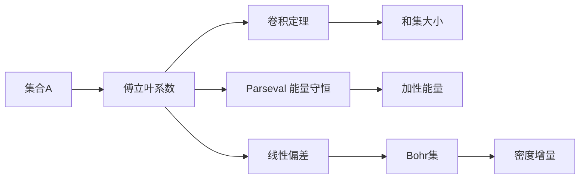

# 第 4 章：傅立叶分析方法

- **难度**：★★★ | **预估学时**：12 小时 | **前置**：第 1、2 章；复变函数与内积空间

## 学习目标

学完本章，你能：

- 写出有限交换群上的特征、傅立叶变换与 Parseval 恒等式
- 用线性偏差解释"一个集合偏向某个方向"是什么意思
- 说清 Bohr 集为什么是"伪随机性"的度量工具
- 用傅立叶系数表达加性能量，并解释它给出的和集下界

## 一句话核心

傅立叶变换把加法卷积变成逐点相乘，于是"和集有多大""能量有多高"这些加法问题，变成了"系数有多集中"的乘法问题。

## 零基础讲解

### 概念 1：特征与傅立叶系数

在有限交换群 Z 上，一个特征是从 Z 到单位圆的同态 ξ: Z → ℂ，满足 ξ(x+y) = ξ(x)ξ(y)。对 ℤ/Nℤ，特征就是 ξ_r(x) = e^{2πirx/N}。

函数 f 的傅立叶变换是

f̂(ξ) = Σ_x f(x) ξ(x) 的共轭，

也就是 f 在每个频率上的投影。集合 A 的指示函数 1_A 的变换记作 Â(ξ)，它衡量 A 与频率 ξ 的"对齐程度"。

### 概念 2：三个基本恒等式

- **逆变换**：f 可以由所有 f̂ 重构。
- **Parseval**：Σ_x |f(x)|² = (1/|Z|) Σ_ξ |f̂(ξ)|²。能量守恒。
- **卷积定理**：(f * g)̂ = f̂ · ĝ。这条是把加法变乘法的关键。

有了卷积定理，A+B 的指示函数（本质是 1_A * 1_B）的傅立叶系数就是 ·B̂，问题立刻从集合层面降到系数的乘积上。

### 概念 3：线性偏差

若 Â(ξ) 明显不为零，称 A 在频率 ξ 上有线性偏差。直观上，A 的元素在"相位 ξ(x)"这个圆周上分布不均匀，偏向某个方向。

偏差的直接后果是：A 在某条"模某个频率"的等差结构上有超出随机的比例。这是第 10 章 Roth 定理的出发点。

**例子**：A 是 [1,N] 里的偶数，取 ξ(x) = (−1)^x，则 Â(ξ) = |A|，偏差最大。这说明"全是偶数"在频率 1 上是完全对齐的。

### 概念 4：Bohr 集

给定一组频率 Δ 和半径 ρ，Bohr 集是

B(Δ, ρ) = { x : 对所有 ξ∈Δ，|ξ(x) − 1| ≤ ρ }。

它是"在若干频率上同时接近 1"的元素的集合，可以理解为"多条等差条件的交集"。在 Z/NZ 里，Bohr 集就是低维 GAP 的傅立叶对偶。

为什么需要它？因为在傅立叶证明里，偏差出现的频率集合往往不是独立的，直接当作独立方向会高估结构。Bohr 集给出了"这些频率共同定义的子群"的正确大小，从而把密度增量控制在可接受范围内。

### 概念 5：(p) 常数与 Bh[g] 集

(p) 常数衡量一个群里的"加法随机性"：对小整数 p，计数 p 元组 (x₁,...,x_p) 满足 x₁+...+x_p=0 的比例偏离 1/|Z| 多少。

Bh[g] 集（也叫 B_h 集）是"每种和最多有 g 种表示"的集合，是 Sidon 集的推广（Sidon 对应 g=1）。它们刻画的是加法表示的稀疏程度，与和集大小是同一件事的两面。

### 概念 6：分离集与谱

分离集指元素之间没有短小的整数线性关系，类似"加法意义上线性无关"。集合 A 的谱是那些使 |Â(ξ)| 大的频率组成的集合。谱小 ⟹ A 的结构接近低维 GAP；谱大 ⟹ A 更随机。

这条"谱大小 ↔ 结构强弱"的对应，是第 5 章反向定理的傅立叶版本。

### 概念 7：和集中的等差数列

本节的核心结论是：只要 A 的傅立叶偏差足够小，A+A 就几乎填满整个群；反过来，若 A+A 没有填满，就必然存在明显的频率偏差。

证明套路是"若没有偏差，则能量小，则和集大"，逆否命题就是"和集小则一定有偏差"。这也是第 10 章密度增量论证的雏形。

## 图示

## 类比与实例

**类比**：把集合想成一段音频信号。时域里看是"哪些位置有声音"，频域里看是"哪些音高在共振"。傅立叶系数就是每个音高的音量。加法卷积在时域里是"回声叠加"，在频域里只是音量相乘——这是它好用的原因。

**失效边界**：音频是连续的，有限群上的频率是离散的；另外集合只有 0/1 值，没有振幅，类比丢掉了这一点。

**实例**：Z = ℤ/8ℤ，A = {0,1,2,3}。Â(0) = 4。Â(4) = Σ_x 1_A(x)(−1)^x = 1−1+1−1 = 0。Â(2) = Σ 1_A(x) i^x = 1+i−1−i = 0。Â(1) = 1 + e^{−iπ/4} + e^{−iπ/2} + e^{−i3π/4}，模长约为 2.6，偏差明显。

这说明"前一半"这个集合在频率 1 上有偏差，符合直觉：它不是随机的。

## 常见误解

- 别以为 Â(ξ) 大就一定有等差数列。偏差只说明"偏向某个频率"，方向可能很复杂。
- 别以为 Parseval 是"能量守恒"的物理定律。它只是内积空间里的勾股定理在群上的写法。
- 别以为 Bohr 集就是 GAP。两者在特定群里有对应关系，但 Bohr 集的定义依赖频率集合，不总是能写成低维 GAP。
- 别以为傅立叶方法能处理 k≥4 的 Szemerédi 定理。线性傅立叶只能看到"一维偏差"，k≥4 需要 Gowers 范数（第 11 章）。

## 自测题（答案）

1. 写出有限群上 Parseval 恒等式，并说明它为什么能用来估能量。（答案：Σ|f|² = (1/|Z|)Σ|f̂|²；解析：把 f 取成 1_A，左边是 |A|，右边给出系数的平方和，与能量的傅立叶表达相联。）
2. 为什么 A 全是偶数时，Â 在频率 1 上最大？（答案：特征 (−1)^x 在偶数上取 1，所有项同号相加；解析：偏差等于"每个元素都对齐同一个相位"。）
3. 傅立叶方法为什么对 k=4 失效？（答案：线性相位只能检测一维偏差，k≥4 需要更高阶的均匀性范数；解析：Gowers 范数本质上是高阶傅立叶，普通傅立叶是它的 k=2 情形。）

## 复习锚点

- 卷积定理是整章的发动机：加法变乘法。
- 偏差大 ⟹ 结构强；无偏差 ⟹ 和集大。
- Bohr 集是"多频率对齐"的正确几何。
- 能量的傅立叶形式是 Σ|Â|⁴。
