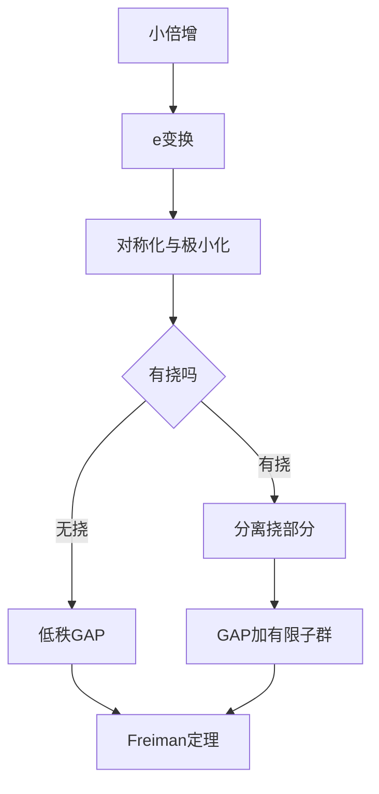

# 第 5 章：逆和集定理

- **难度**：★★★★ | **预估学时**：14 小时 | **前置**：第 2、3、4 章

## 学习目标

学完本章，你能：

- 说清"正向估计"和"逆向结构"的分界：知道 σ 小到什么程度才能得到什么结论
- 用 e-变换解释为什么可以假设集合对称、且和集最小
- 写出 Freiman 同态的定义，并说明它为什么比群同态弱
- 叙述无挠情形下的 Freiman 定理：小倍增 ⟹ 低秩 GAP

## 一句话核心

第 2 章告诉我们"和集小会牵动别的和集"，本章要回答更硬的问题：和集小，A 本身长什么样？答案是无挠时 A 落在一个低秩等差数列里，有挠时要先把挠部分分离出去。

## 零基础讲解

### 概念 1：问题为什么难

"|A+A| ≤ K|A|"只是一个大小的约束。满足它的集合可以很不一样：子群、等差数列、GAP，甚至它们的并集加几个杂点。要从一个数量不等式反推出结构，必须找到一种"只依赖加性关系"的规范形式，把所有等价的外观统一掉。

### 概念 2：e-变换

给定集合 A 和元素 a∈A，e-变换把 A 换成 (A ∪ (A+a)) 或者 (A ∩ (A+a)) 的某种组合，目标是在保持 |A+A| 不增的前提下，让集合更"对称"、更"规整"。

它的作用像"整理房间"：不改变房间总面积（和集大小），但把东西挪到该在的位置，方便后面描述。

反复做 e-变换，可以假设 A 满足"对称性"和"极小性"，这是很多证明的第一步归约。

### 概念 3：Freiman 同态

φ: A → B 是 Freiman 同态，指它保持加法关系：若 a₁+a₂ = a₃+a₄（在 A 所在的群里），则 φ(a₁)+φ(a₂) = φ(a₃)+φ(a₄)。

它比群同态弱得多：不需要对 A 之外的元素有定义，也不要求单射。但它足够强，能把"加法结构"从一个集合搬到另一个集合。

**例子**：A = {0,1,2}，B = {0,1,4}，φ(0)=0, φ(1)=1, φ(2)=4。A 里 0+2 = 1+1，映射后 0+4 = 1+1 不成立，所以 φ 不是 Freiman 同态。换 φ(2)=2 就行。

### 概念 4：无挠情形下的 Freiman 定理

定理大意：若 A ⊂ ℤ^d 且 |A+A| ≤ K|A|，则存在秩不超过 d(K)、大小不超过 C(K)|A| 的 GAP，包含 A。

这里 d(K) 和 C(K) 只依赖 K，不依赖 |A|。这是"小倍增 ⟹ 低秩结构"的定量版本，也是全书最重要的结构定理。

K 很小（σ < 2 或 < 3）时，结论可以精确到"子群 + 小扰动"或者"低维 GAP"。K 到 log|A| 量级时，只能给出 GAP，秩和体积都变大。

### 概念 5：挠与无挠

群里有元素满足 mx = 0（m 为正整数），叫有挠。ℤ/Nℤ 全是挠，ℤ^d 无挠。

有挠时，A 可能落在"子群 + GAP"的混合结构里，比如 A 的一部分落在一个有限子群里，另一部分沿某个方向排开。这时不能指望单一 GAP 描述，必须先做"挠部分分离"。

### 概念 6：万能环境群

给定 A 的加法关系，可以构造一个"最大"的群，使 A 嵌入其中且所有加法关系保持。这叫万能环境群，作用是让"结构定理"不依赖具体的环境群：先把 A 搬到一个规范的大群里，再在里面找 GAP。

这一步是技术性的，但很关键：没有它，定理在不同环境群里要分别陈述，没法统一。

### 概念 7：任意群里的 Freiman 定理

最终版本把"无挠"换成"商掉挠子群"：A 落在一个"低秩 GAP + 有限子群"的结构里，参数只依赖 K。

## 图示

## 类比与实例

**类比**：一堆散落的棋子，如果它们"两两相加的结果很少"，说明棋子其实排在一张规则的棋盘上。e-变换是把棋子挪到棋盘的格点上，Freiman 定理是说"一定能找到这样一张棋盘，格子数不超过棋子数的常数倍"。

**失效边界**：棋盘是二维的，定理里的秩可能很高；类比也看不出"常数倍"到底多大。

**实例**：A = {0,1,2,3,4} ⊂ ℤ。|A+A| = 9，σ = 1.8。A 本身就是秩 1、长度 4 的 GAP，定理结论平凡成立。

再取 A = {0,1,2} ∪ {100,101,102}。|A+A| 比 6 大不少，σ ≈ 3 左右。它不是一个 GAP，但可以被两个长度 2 的 GAP 覆盖——这说明"覆盖"和"包含"是两回事，定理给的是包含于一个更大的 GAP。

## 常见误解

- 别以为 Freiman 定理给出了 A 的精确形状。它只保证 A 落在一个 GAP 里，GAP 里可能有大量不属于 A 的点。
- 别以为常数 C(K) 很小。K 增大时 C(K) 增长很快，实际应用里经常只能得到"存在但巨大"的界。
- 别以为有挠只是技术细节。ℤ/Nℤ 里的结构可以完全是子群，跟整数情形差别很大。
- 别以为 Freiman 同态就是群同态。它只保持 A 内部的加法关系，定义域外的东西不管。

## 自测题（答案）

1. 为什么 e-变换要保持 |A+A| 不增？（答案：它是归约工具，若和集变大就失去了"小倍增"的前提；解析：所有后续估计都建立在 |A+A| ≤ K|A| 上。）
2. Freiman 定理的结论里，GAP 的秩依赖什么？（答案：只依赖倍增常数 K，不依赖 |A|；解析：这正是定理"定量结构"的体现。）
3. 有挠群里为什么不能直接套无挠版本？（答案：子群部分会破坏"单一 GAP 包含"的结论；解析：需要先把挠部分分离，再对无挠商施用定理。）

## 复习锚点

- 正向给大小，逆向给形状；本章是逆向。
- e-变换负责"整理"，不改变和集大小。
- Freiman：小倍增 ⟹ 低秩 GAP，参数只依赖 K。
- 有挠先分离，无挠再套定理。
