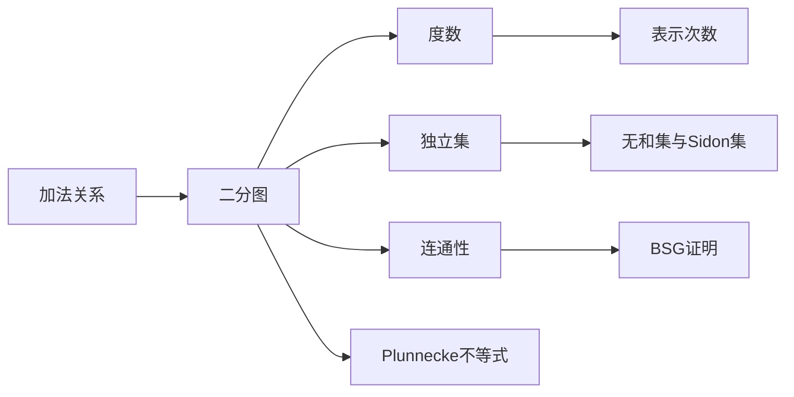

# 第 6 章：图论方法

- **难度**：★★★ | **预估学时**：8 小时 | **前置**：第 2 章；基础图论

## 学习目标

学完本章，你能：

- 用 Turán 定理给出独立集的下界，并说明它怎么用来构造无和集
- 解释 Ramsey 定理与 van der Waerden 定理的关系
- 用图的连通性重述 BSG 定理的证明思路
- 写出 Plünnecke 不等式的适用条件，知道它为什么比 BSG 更"正向"

## 一句话核心

把加法关系画成图，和集大小就变成了"顶点覆盖"或"边密度"；图论里的独立集、匹配、连通性，分别对应组合里的无和集、部分和、结构提取。

## 零基础讲解

### 概念 1：为什么加性组合学会用到图

很多加性问题可以先固定一侧：给定 A，把每个 a∈A 和它对应的"伙伴"用边连起来。于是"存在一个没有某种和结构的子集"等价于"图里存在独立集"；"某个元素表示次数很多"等价于"某个顶点度数很高"。图论工具处理的就是这些度数、连通性、独立集的问题。

### 概念 2：Turán 定理与无和集

Turán 定理：n 个顶点、e 条边的图，独立集至少有 n²/(2e+n) 个顶点。

应用方式：把"禁止出现的和"作为边。若 A 是无和集（A 中不存在 x+y=z），要构造尽量大的无和子集。把 {1,...,n} 里所有满足 x+y=z 的 (x,z) 连边，得到一个图，独立集就是无和集。代入 e 的估计就得到"最大无和集至少 n/3"这类结论。

**要点**：Turán 给的是下界，构造用的是"取最大独立集"，不需要显式写出来。

### 概念 3：Sidon 集与独立集

Sidon 集指所有两两和 a+b（a≤b）互不相同。它等价于说"把和当边时图里没有长度为 2 的重复路径"。

Sidon 集的大小上界约为 √n（在 [1,n] 里），这个界可以用计数直接得到，也可以用图论里的"三角形个数"来证。

### 概念 4：Ramsey 与 van der Waerden

Ramsey 定理：给足够大的完全图的边染 r 种颜色，必有一种颜色包含一个大小给定的单色团。

van der Waerden 定理：把足够长的整数区间染成 r 种颜色，必有一种颜色包含任意长的等差数列。

两者的关系是"结构版本的抽屉原理"：颜色数固定、长度固定，只要区间足够长，单色结构必然出现。第 6.3 节用 Ramsey 定理给出 van der Waerden 的一个证明。

**注意**：这些定理给的是"存在"，界通常巨大（Ackermann 级别），不能直接用于定量估计。

### 概念 5：用连通性证明 BSG

BSG 定理要证"能量大 ⟹ 存在大子集使和集小"。图论版本的思路：

1. 把 A、B 之间的"和关系"建成一个二分图，边表示 a+b 落在某个小集合里。
2. 能量大意味着边多。
3. 边多的图要么有一个度数很高的顶点，要么有一块稠密的子图。
4. 稠密子图里可以抽出大的匹配或连通块，对应到 A'、B'。
5. 连通性保证 A'+B' 被少数几个平移覆盖，于是和集小。

这条证明的好处是"只看边数，不看加法细节"，因此可以推广到非交换群。

### 概念 6：Plünnecke 不等式

Plünnecke 的结果大致是：若 |A+B| ≤ K|B|，则对任意正整数 k、l，

|kA + lB| ≤ K^{k+l} |B|。

其中 kA 表示 A 的 k 重和集。它把"一次相加的膨胀率"控制住，就自动控制了多次相加的膨胀率。

和 BSG 的区别：BSG 是"能量大 ⟹ 找子集"，是逆向的、要损失子集；Plünnecke 是"一次小 ⟹ 多次也小"，是正向的、不损失集合。两者配合使用：先用 Plünnecke 控制多次和集，再用 BSG 从能量反推结构。

## 图示

## 类比与实例

**类比**：把加性关系想成"社交网络"。两个人如果能凑出某个和，就连一条边。无和集就是"互不相连的一群人"（独立集）；表示次数多就是"某人是社交中心"（高度数顶点）；BSG 就是说"如果网络里的边特别多，必然有一块小圈子内部联系极密"。

**失效边界**：社交网络是有向、带权、随时间变化的，这里的图是静态简单图。

**实例**：A = {1,2,...,n}，把 x+y=z 的 (x,z) 连边。顶点 z 的度数约等于"z 有多少种拆分"，最大约 n/2。用 Turán 定理估独立集，e 约 n²/4（每个 z 有 O(z) 种拆分，求和约 n²/4），代入得独立集 ≥ n²/(2e+n) ≈ n²/(n²/2) ≈ 2，这个下界太弱——实际最大无和集是 ⌈n/2⌉ 个奇数。这说明 Turán 是通用工具，具体问题上还要挑更好的图或者更细的计数。

## 常见误解

- 别以为 Turán 定理给出的界总是紧的。它只保证存在，界经常很松。
- 别以为 Ramsey 定理能给出可用的定量界。它的界增长极快，实际证明里只用来保证存在。
- 别以为 Plünnecke 和 BSG 是一回事。前者不损失集合，后者必须损失到子集。
- 别以为图论方法只适用于离散集合。它也能处理连续群，只要能把关系离散化。

## 自测题（答案）

1. Turán 定理的独立集下界公式是什么？（答案：n²/(2e+n)；解析：由平均度数推出存在大独立集的经典估计。）
2. 为什么 Plünnecke 不等式里指数是 k+l？（答案：每多一层和集就多乘一次膨胀率 K；解析：|kA+lB| 相当于做了 k+l 次"加 B"的操作。）
3. BSG 的图论证明里，为什么要找"连通块"而不只是"匹配"？（答案：连通性才能保证子集的和被少数平移覆盖；解析：匹配只保证配对，不保证整体结构。）

## 复习锚点

- 图是加法关系的"骨架"，独立集对应无和集。
- Ramsey 与 van der Waerden 是存在性工具，界不可用。
- BSG 逆向、Plünnecke 正向，配合使用。
- 度数大 ⟹ 表示次数多 ⟹ 能量大。
