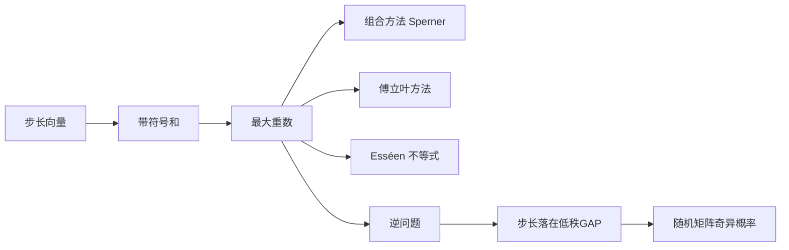

# 第 7 章：Littlewood–Offord 问题

- **难度**：★★★ | **预估学时**：8 小时 | **前置**：第 1、4 章；线性代数

## 学习目标

学完本章，你能：

- 说清 Littlewood–Offord 问题在问什么：子集和最多能重复多少次
- 用 Sperner 定理和傅立叶两种方法给出集中上界
- 叙述 Esséen 集中不等式，知道它为什么只依赖步长的平方和
- 解释随机 Bernoulli 矩阵为什么大概率可逆，以及逆 Littlewood–Offord 在其中的作用

## 一句话核心

给 d 个步长 v₁,...,v_d，考虑所有 2^d 个带符号和；Littlewood–Offord 问这些和最多能挤到多密，逆问题问如果挤得很密，步长必须长什么样。

## 零基础讲解

### 概念 1：问题设定

取 v₁,...,v_d ∈ Z，考虑 2^d 个和

ε₁v₁ + ... + ε_dv_d，ε_i ∈ {−1, +1}。

如果步长都是 1，和只取 −d, −d+2, ..., d 共 d+1 个值，平均每个值有 2^d/(d+1) 个表示，集中度约 2^d/d。

如果步长是 2 的幂，每个和都唯一，集中度为 1。

前者是"最集中"的极端，后者是"最分散"的极端。Littlewood–Offord 要给出前者到底能多集中。

### 概念 2：组合方法（Sperner）

把每个子集对应到 {1,...,d} 的子集。若所有步长非零且互不相同（或者满足一定的"无短关系"条件），可以证明最大重数不超过 C(2d,d) 量级，也就是约 2^d/√d。

**直觉**：要让两个不同的符号向量给出同一个和，必须有 Σ δ_i v_i = 0，其中 δ_i ∈ {−2,0,2}。步长越"独立"，这种关系越少。

Sperner 定理在这里的作用是：把"和为定值"的族看成反链，反链大小受组合数控制。

### 概念 3：傅立叶方法

集中度可以写成概率形式：随机取 ε_i，问 P(Σ ε_i v_i = x) 最大是多少。用傅立叶展开，这个概率等于

(1/|Z|) Σ_ξ ∏ cos(2π ξ(v_i)/|Z|)。

要估这个式子，就要控制连乘积的衰减。步长越"分散"，cos 因子衰减越快，概率越小。这条路线给出的是"依赖步长分布"的界，比纯组合方法更细。

### 概念 4：Esséen 集中不等式

Esséen 的结果给出集中函数的上界，形式大致是

sup_x P(Σ ε_i v_i = x) ≤ C / √(Σ |v_i|²)。

它只依赖步长的平方和，不依赖步长之间的具体关系。这条不等式在随机矩阵、概率论里用得很广。

**为什么只依赖平方和？** 因为带符号和的方差就是 Σ|v_i|²，集中度不会超过"方差给出的上限"太多。这是"用二阶矩控制集中"的典型。

### 概念 5：逆 Littlewood–Offord

正向问"最多能多集中"，逆向问"如果集中度很大，步长必须满足什么"。

结论大致是：若存在 x 使 P(Σ ε_i v_i = x) 很大，则绝大部分 v_i 落在一个低秩 GAP 里（除去少数例外）。这和 Freiman 定理的形状完全平行：集中度大 ⟺ 步长有加性结构。

证明思路：先用 Esséen 得到"方差不能太大"，再用傅立叶/组合方法把"集中"翻译成"步长之间的整数关系多"，最后套用 Freiman 型结构定理。

### 概念 6：随机 Bernoulli 矩阵

一个 n×n 的 0-1 随机矩阵，元素独立、取 1 的概率 1/2。它奇异的概率有多大？

如果两列相同，就奇异。两列相同的概率是 2^{−n}，列对数是 n²，所以"有相同列"的概率约 n²2^{−n}，很小。但奇异还有别的成因，比如某列是其他列的整系数组合。

用逆 Littlewood–Offord 可以证明：奇异概率大约是 (1/2 + o(1))^n 量级。思路是"若矩阵奇异，则存在非零整数向量 x 使 Ax=0，即若干列的和为零，这正是一个集中事件"。

### 概念 7：二次 Littlewood–Offord

把线性关系换成二次型：问 ε_i 的二次表达式集中到什么程度。这类问题出现在随机二次型、图谱理论里。结论的形式和线性情形类似，但"结构"变成了"低秩二次型"。

## 图示

## 类比与实例

**类比**：把 2^d 个符号向量想成 2^d 个人，每人的"存款"是 Σ ε_i v_i。问最多有多少人存款相同。步长像面额：如果面额都是 1 元，存款值只有 d+1 种，人挤得很厉害；如果面额是 1,2,4,8,...，每人存款都不同。

**失效边界**：现实货币是离散且有限的，数学里的群可以是任意交换群。

**实例**：d = 3，步长 1,1,1。可能的和是 −3,−1,1,3，各出现 1,3,3,1 次，最大重数 3 = C(3,1)。d = 3，步长 1,2,4，八个和是 ±1±2±4，全部不同，最大重数 1。

这个对比说明"步长的整数关系"直接决定集中度。

## 常见误解

- 别以为 Esséen 不等式对所有步长都紧。步长全相同时它给出的界可能偏松，但量级正确。
- 别以为逆 Littlewood–Offord 能刻画全部步长。它只能保证"绝大多数"落在 GAP 里，少数例外可以很乱。
- 别以为随机矩阵奇异只由"列相同"造成。列之间的整数线性组合才是主因，这正是需要用逆定理的地方。
- 别以为这个问题只和概率有关。它的证明大量使用加性组合的结构定理。

## 自测题（答案）

1. 步长全为 1 时，最大重数是多少量级？（答案：约 2^d/√d；解析：二项式系数 C(d,k) 的最大值在中间，约 2^d/√d。）
2. Esséen 不等式依赖步长的什么量？（答案：平方和 Σ|v_i|²；解析：它本质上是方差控制的集中不等式。）
3. 随机 Bernoulli 矩阵奇异的概率为什么是指数小？（答案：奇异意味着列之间存在非平凡整数关系，这是集中事件，概率指数小；解析：用逆 Littlewood–Offord 把"奇异"转化为"步长集中在低秩结构"，再估概率。）

## 复习锚点

- 集中度大 ⟺ 步长有整数关系 ⟺ 落在低秩 GAP。
- 组合方法给组合数界，傅立叶方法给依赖分布的界，Esséen 给方差界。
- 正问题是"最多多集中"，逆问题是"集中则步长如何"。
