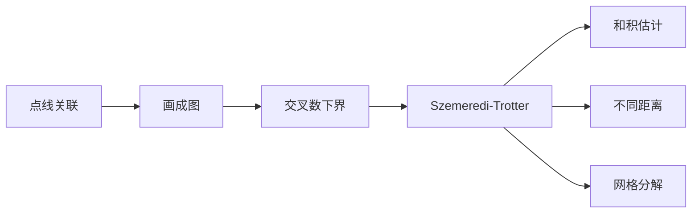

# 第 8 章：关联几何

- **难度**：★★★ | **预估学时**：7 小时 | **前置**：第 2 章；一点平面几何与图论

## 学习目标

学完本章，你能：

- 用"画图时的交叉数"解释 Szemerédi–Trotter 定理的来源
- 写出点线关联上界，并用它推出一个和积估计
- 说清"网格分解"为什么能把几何问题降成组合计数
- 知道这套方法在实数域、有限域里的差别

## 一句话核心

点上、线上、圆上的关联数量受几何约束；把关联数用两种方式各数一遍（双重计数），就能得到和积问题所需的下界。

## 零基础讲解

### 概念 1：关联

一个点落在一条线上，叫一次关联。给定点集 P 和线集 L，记 I(P,L) 为关联的总次数。

最平凡的上界是 |P||L|，但那太松。真正的问题是：点和线的数量固定时，关联最多能有多少？

### 概念 2：交叉数与欧拉公式

把图画在平面上，边与边之间的交叉次数有下界：若图有 n 个顶点、m 条边、n≥3，则交叉数至少是 m − 3n + 6。

来源是欧拉公式：平面图的边数不超过 3n−6，超过的部分必须靠交叉"塞"进去。

这条不等式看起来只是拓扑事实，但它是 Szemerédi–Trotter 证明的起点：把"点—线"关联画成图，关联多就意味着边多，边多就意味着交叉多；而交叉本身又可以用"两条线最多交一次"来数，于是得到矛盾或上界。

### 概念 3：Szemerédi–Trotter 定理

对平面上的点集 P 和线集 L，

I(P,L) ≲ |P|^{2/3}|L|^{2/3} + |P| + |L|。

这个界在量级上是最优的：构造取"n×n 网格点 + 所有水平、垂直、斜率有理的线"，可以得到接近这个上界的关联数。

**为什么是 2/3 次方？** 因为交叉数下界是线性的，而"每条线穿过多少点"与"每两条线的交叉"之间存在二次关系，优化后指数落在 2/3。

### 概念 4：用关联推和积

Erdős–Szemerédi 的和积猜想是：对实数集 A，

max(|A+A|, |A·A|) ≳ |A|^{1+δ}，

δ 是一个正常数。直观上，加法结构和乘法结构不能同时很强。

用关联几何证明的思路：把 A 的元素画在坐标轴上，考虑"斜率为 1 的线"与"乘积相同的双曲线"。若 |A+A| 很小，说明很多点对的和相同，也就是很多点落在同一条斜线 y = c − x 上；若 |A·A| 也很小，说明很多点对落在同一条双曲线 xy = c 上。线与线的交点数受 Szemerédi–Trotter 控制，两者冲突。

这条路线给出的是 δ 很小的定量版本，但已经是"初等"证明里最强的之一。

### 概念 5：网格分解与不同距离问题

网格分解（cell decomposition）是把平面切成若干格子，每个格子里"点—线"关系近似规整。切分的粗细由关联数决定：关联少就切得粗，关联多就切得细。

用它处理不同距离问题：n 个点的不同距离个数至少是多少？平面上的经典结果是 n/√(log n) 量级，网格分解给出的是这个问题的组合版本。

### 概念 6：其他域上的和积

实数域靠"序"和"凸性"，有限域没有序，只能靠多项式方法（第 9 章）和傅立叶。有限域上的和积估计通常形如 |A+A|·|A·A| ≳ |A|^{2+c}，证明用组合零点定理或者 Stepanov 方法。

## 图示

## 类比与实例

**类比**：把点想成钉子，线想成橡皮筋。钉子多、橡皮筋少时，每根皮筋要串很多钉子，但皮筋之间必然频繁交叉。交叉的次数是"几何账单"，关联数不能超过账单允许的量。

**失效边界**：三维空间里两条直线可以不相交也可以异面，交叉数的下界不再成立，需要换成别的几何工具。

**实例**：取 3×3 的网格点，P 有 9 个点。取所有水平线和垂直线，L 有 6 条，每条穿 3 个点，I = 18。代入公式：9^{2/3}·6^{2/3} ≈ 4.33·3.30 ≈ 14.3，加上 9+6 后界更松，18 在界内。

这个例子说明公式里的 |P|+|L| 项在小规模时占主导。

## 常见误解

- 别以为 Szemerédi–Trotter 只对平面成立。它有高维推广，但形式会变。
- 别以为关联上界能直接给出强和积结论。它给的是 δ 很小的版本，强版本需要更精细的工具。
- 别以为交叉数下界对所有图都成立。n≥3 且是简单图才成立，重边、自环要单独处理。
- 别以为有限域情形可以照搬实数域证明。"序"在有限域里不存在，必须换成代数方法。

## 自测题（答案）

1. 平面图 n 个顶点最多有多少条边？（答案：3n−6，n≥3；解析：欧拉公式给出面数上界，再由每个面至少三条边推出。）
2. Szemerédi–Trotter 的 2/3 指数从哪里来？（答案：交叉数下界与关联上界的优化；解析：把每条线的关联数记为 d，交叉数约 Σd²，与 m−3n 比较后优化。）
3. 为什么和积问题需要几何工具？（答案：加法结构对应斜线，乘法结构对应双曲线，冲突体现在交点数；解析：两种结构不能同时让关联数很小。）

## 复习锚点

- 关联 = 点落在线上；双重计数是核心手法。
- 交叉数下界 m−3n+6 来自欧拉公式。
- S-T 界：|P|^{2/3}|L|^{2/3}+|P|+|L|。
- 实数域靠几何，有限域靠代数。
