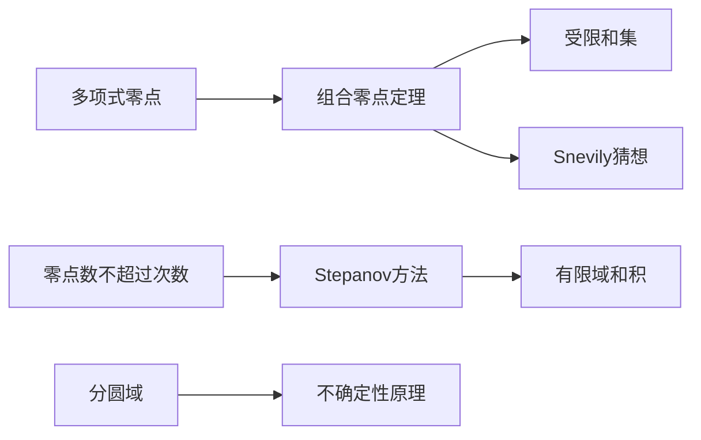

# 第 9 章：代数方法

- **难度**：★★★★ | **预估学时**：10 小时 | **前置**：第 2、4 章；多项式与有限域基础

## 学习目标

学完本章，你能：

- 叙述组合零点定理，并说明"系数非零"这个条件为什么关键
- 用零点定理证明一个受限和集的大小下界
- 区分 Davenport 常数与 Kemnitz 猜想在问什么
- 解释 Stepanov 方法怎么把"存在性"变成"多项式次数估计"

## 一句话核心

在域上，加性集合可以看成多项式的零点集；用"多项式的零点数受次数控制"这一条，就能把组合问题变成次数比较。

## 零基础讲解

### 概念 1：组合零点定理

设 F 是域，P 是 n 元多项式，次数不超过 Σ t_i，且 P 中 x₁^{t₁}...x_n^{t_n} 这一项的系数不为零。若 S₁,...,S_n 是 F 的子集且 |S_i| > t_i，则存在 x_i ∈ S_i 使 P(x₁,...,x_n) ≠ 0。

**直觉**：如果 P 在所有格点 S₁×...×S_n 上都取零，那么它的"最高次项"必须被压掉，而系数非零恰好禁止这件事。

**为什么条件这么严？** 因为这是"插值"的精确版：在 |S_i| 个点上取零，相当于要求 P 被这些点定义的理想整除，次数不够就做不到。

### 概念 2：受限和集

受限和集是指形如 A ⊕ B = {a+b : a∈A, b∈B, a≠b} 的集合（禁止同元素相加）。

Erdős–Heilbronn 猜想断言：在 ℤ/pℤ 里，|A ⊕ A| 至少是 min(p, 2|A|−3)。用组合零点定理可以给出 p 较大时的证明：构造一个多项式，它在所有"和"上取零，再用"最高次项系数非零"导出矛盾。

**思路细节**：把"和不在某个集合里"翻译成多项式在格点上非零，再数格点数量，与次数比较。

### 概念 3：Snevily 猜想

Snevily 猜想说：在奇特征的循环群里，给定两个大小相同的集合 A、B，存在一个置换 π 使所有 a+π(a) 互不相同。

它等价于"存在一个无重复的匹配"。组合零点定理可以处理其中一部分情形（A、B 是区间或者有特殊结构时）。

### 概念 4：有限域与 Davenport 常数

Davenport 常数 D(G) 是最小的 k，使得 G 里任意 k 个元素（允许重复）都有一个非空子集和为 0。

对 ℤ/nℤ，D = n。对 (ℤ/nℤ)^d，D 约为 n(1+log n)。这个常数在零和问题、代数数论里都出现。

Kemnitz 猜想是它的二维版本：在 ℤ/nℤ 的平面格点里，最小的 k 使任意 k 个点都有子集和为零（模 n），猜想值是 4n−3。

### 概念 5：Stepanov 方法

要证"某个集合很大"，直接数很难。Stepanov 的办法是：构造一个次数不太高的多项式，它在集合的每个点上取零，然后用"零点数 ≤ 次数"反推集合大小上界（或下界）。

它和零点定理是"一枚硬币的两面"：零点定理从"非零"推"存在格点"，Stepanov 从"处处为零"推"次数必须大"。

### 概念 6：分圆域与不确定性原理

分圆域是有理数域添加单位根得到的扩域，它的代数结构对应循环群的傅立叶分析。书里用它处理"有限域上的加法结构"。

不确定性原理在这里的形式是：一个函数和它的傅立叶变换不能同时"集中"。离散版本就是"集合小 ⟹ 谱大"，与第 4 章的偏差分析同源。

## 图示

## 类比与实例

**类比**：多项式像一张"有限次起伏的布"，零点就是布贴到地面的位置。次数低，布起伏的次数少，贴地点就少。组合零点定理说：如果布在格点上全部贴地，而它本可以起伏到更高，说明它是"假贴地"，必有某个格点没贴。

**失效边界**：这个类比只在一维直觉上成立，多维时"次数"要把每个变量的次数加起来。

**实例**：p = 7，A = {0,1,3} ⊂ ℤ/7ℤ。受限和 A ⊕ A = {1,3,4,0+?}：允许的组合是 0+1=1, 0+3=3, 1+3=4, 3+1=4, 1+0=1, 3+0=3，实际集合 {1,3,4}，大小 3。而 2|A|−3 = 3，正好达到下界。

这个例子说明 Erdős–Heilbronn 的界在小集合时可以很紧。

## 常见误解

- 别以为组合零点定理对任意环成立。它需要域，整环上"零点数 ≤ 次数"不总成立。
- 别以为系数非零是技术细节。去掉它，定理立刻变假，因为可以构造出在所有格点上为零但次数很低的例子。
- 别以为 Davenport 常数就是"元素个数"。它问的是"任意 k 个元素"，包括重复，和集合大小无关。
- 别以为 Stepanov 方法只能给上界。它常常被用来证明"集合不能太小"，方向取决于你把零点放在哪一侧。

## 自测题（答案）

1. 组合零点定理中，为什么要 |S_i| > t_i？（答案：格点数量要超过次数上界，才能保证存在非零点；解析：若 |S_i| ≤ t_i，多项式可以在整个格点上取零而不违反次数限制。）
2. Erdős–Heilbronn 猜想的值是多少？（答案：min(p, 2|A|−3)；解析：这是受限和集在 ℤ/pℤ 中的经典猜想下界。）
3. Stepanov 方法的核心不等式是什么？（答案：零点数不超过多项式的次数；解析：这是域上多项式最基本的性质，方法就是把它反过来用。）

## 复习锚点

- 零点定理：次数 + 系数非零 ⟹ 格点上存在非零点。
- 受限和集与零和问题都靠多项式构造。
- Stepanov 用"零点 ≤ 次数"反推集合大小。
- 有限域没有序，只能靠代数。
