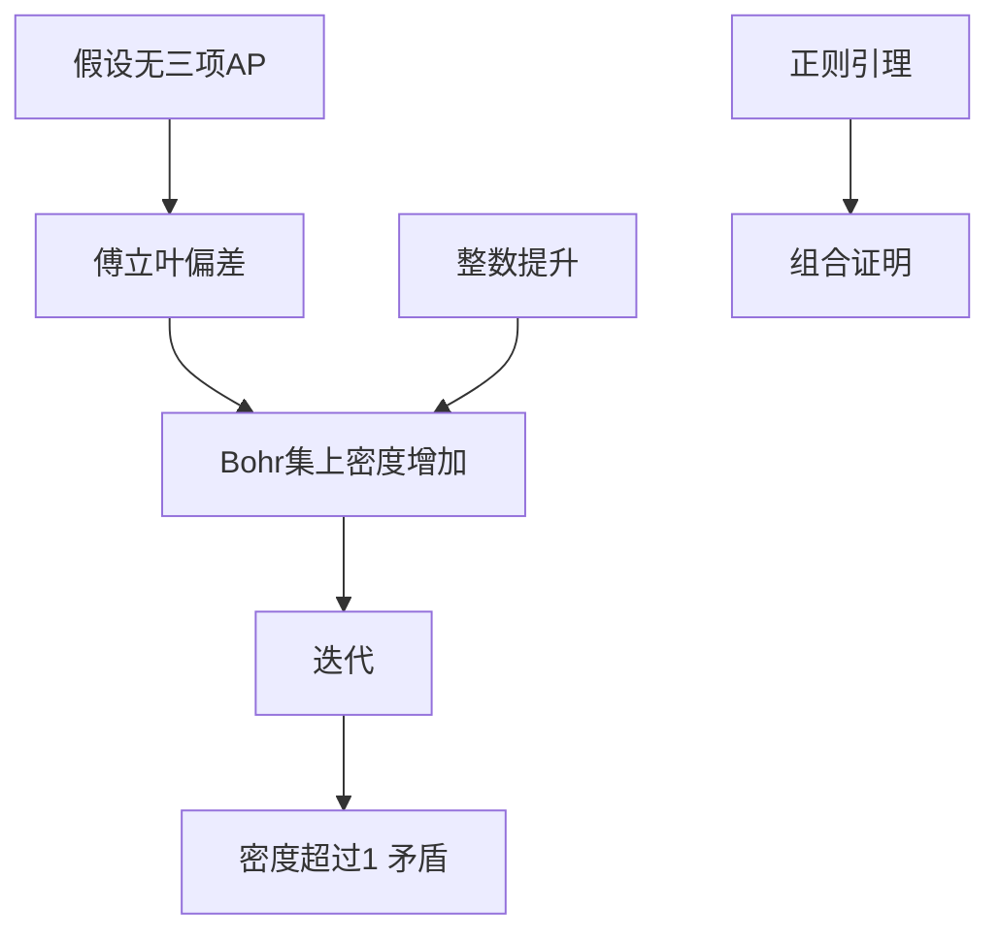

# 第 10 章：k=3 的 Szemerédi 定理

- **难度**：★★★★ | **预估学时**：14 小时 | **前置**：第 4 章；第 2 章；一点测论

## 学习目标

学完本章，你能：

- 复述 Szemerédi 定理：正上密度的整数集包含任意长的等差数列
- 说清"密度增量"策略：假设没有 3 项等差数列，推出密度在某个子结构上变大
- 解释小挠情形与整数情形的分工
- 知道傅立叶方法在这里的角色，以及它为什么只能处理 k=3

## 一句话核心

若 A 没有 3 项等差数列，则 A 在某个 Bohr 集上的密度必然比原来高；不断把密度往上推，最后超过 1，矛盾。

## 零基础讲解

### 概念 1：定理与历史

Szemerédi 定理：正整数集的子集 A 若有正上密度，则 A 包含任意长的等差数列。

k=3 的情形最早由 Roth 在 1953 年用傅立叶方法证明。k=4 要等到 1969 年，Szemerédi 用了复杂的组合论证；一般 k 在 1975 年完成。

**为什么 k=3 特别？** 因为 3 项等差数列的结构可以用"一个频率的偏差"完全捕捉：a, a+d, a+2d 三项，中间项是两端的中点。傅立叶系数能直接检测这种"中点关系"。

### 概念 2：密度增量策略

假设 A ⊂ [1,N] 没有 3 项等差数列，密度为 δ。

第一步：用傅立叶分析证明，若 A 没有 3 项等差数列，则存在一个频率 ξ 使 |Â(ξ)| 明显大（否则 A 太"随机"，必然出现等差数列）。

第二步：把"偏差大"翻译成"存在一个 Bohr 集 B，A 在 B 上的密度至少是 δ + c(δ)"。

第三步：把 B 当成新的环境（它是一个低维 GAP），在里面重新开始。

第四步：每次密度至少增加 c(δ)，而密度不超过 1，所以迭代次数有界。迭代到尺度小于常数时，直接检查有限情形，矛盾。

**关键点**：每一步密度增量只依赖当前密度，不依赖 N。这是"定量证明"能给出显式界的原因。

### 概念 3：小挠情形

先在有限群 ℤ/Nℤ 里做，N 不大或者挠很小。这时 Bohr 集就是低维子群，密度增量可以直接算。

"小挠"指群里没有太小的子群，避免 A 整个落在小子群里导致密度虚高。处理后可以假设群"足够分散"。

### 概念 4：整数情形

把 [1,N] 里的 A 通过"提升"（lifting）搬到 ℤ/Nℤ 或者一个大的循环群里。提升的技巧是把区间分成若干段，每段对应一个同余类。

提升的好处是把"区间"变成"群"，坏处是密度会被稀释，需要在参数上补偿。

### 概念 5：定量界

Roth 的原始证明给出的是 log log N 量级的界；后来的改进把它推进到 (log N)^c 量级。Gowers 对 k≥4 给出了更差的界，但仍是显式的。

**这些界意味着什么？** 它们说明"只要 N 足够大，任何密度为正的集合都必然含 3 项等差数列"，但"足够大"可能大到无法实际检验。

### 概念 6：遍历论证

Furstenberg 用遍历理论重证了 Szemerédi 定理：把集合的平移看成动力系统，等差数列对应"回归"（recurrence）。这条路线不给出定量界，但结构清晰，后来发展出"遍历方法"这一整套工具。

书里给出的是"有限版本"的遍历论证，用测论语言重述密度增量。

### 概念 7：正则引理与 Szemerédi 的组合证明

Szemerédi 正则引理：任意大的图都可以分成常数多块，块内边密度近似一致，块间近似随机。它是"把图变得像随机图"的工具。

Szemerédi 的原始证明用它把集合分解成"结构化部分 + 随机部分"，结构化部分含等差数列，随机部分用计数处理。这条路线后来被推广成"超图移除引理"，是第 11 章的基础。

## 图示

## 类比与实例

**类比**：想象你在一个池塘里捞鱼，假设"没有三条鱼排成等距"。每捞一次，你发现某个小区域里鱼的比例更高，于是把注意力集中到那个小区域再捞。区域越来越小，鱼的比例越来越高，最后超过 100%，说明假设不成立。

**失效边界**：池塘是有限的，而定理里的 N 可以任意大；类比里"区域"是空间，定理里是 Bohr 集（频率空间）。

**实例**：取 A 为 [1,10] 里的 {1,2,4,5,7,8,10}，密度 0.7。它含 3 项等差数列吗？1,4,7 是；2,5,8 是。取一个刻意避开等差数列的集合，比如 {1,2,4,8}（密度 0.4），没有 3 项等差数列。但 N 再大一些，这种"稀疏构造"就维持不住了。

## 常见误解

- 别以为密度增量每步增加一个固定常数。增量依赖当前密度 δ，δ 越大概率增量越小。
- 别以为傅立叶方法能直接推到 k≥4。三项等差数列是"中点关系"，可以用一个频率检测；四项及以上需要高阶结构。
- 别以为遍历论证给出了可用界。它只证存在，不给定量估计。
- 别以为正则引理只用于图论。它是"分解结构"的通用工具，在加性组合里也有对应版本。

## 自测题（答案）

1. Szemerédi 定理的结论是什么？（答案：正上密度的整数集包含任意长的等差数列；解析：注意是"任意长"，不是某个固定长度。）
2. 密度增量策略为什么能终止？（答案：密度每次至少增加 c(δ)，且有上界 1；解析：迭代次数由 δ 决定，与 N 无关。）
3. 为什么 k=3 可以用傅立叶，k=4 不行？（答案：3 项 AP 是两点中点关系，线性相位可检测；4 项需要二阶结构；解析：Gowers 范数 U^3 才能捕捉 4 项 AP。）

## 复习锚点

- 定理：正密度 ⟹ 任意长 AP。
- 策略：无 AP ⟹ 有偏差 ⟹ Bohr 集上密度增加 ⟹ 迭代矛盾。
- 界是显式的但很弱。
- k=3 用线性傅立叶，k≥4 要换工具。
