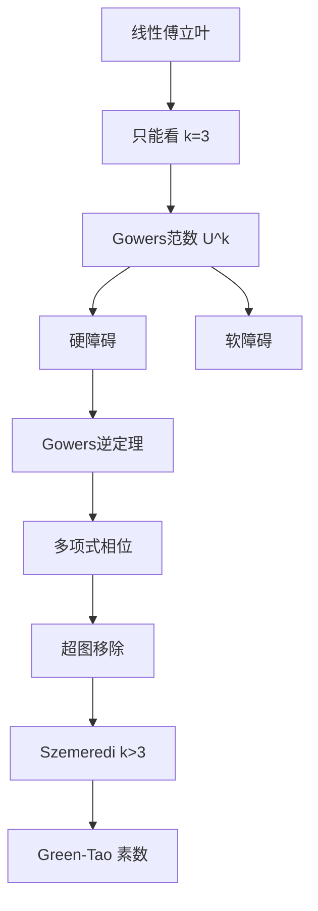

# 第 11 章：k>3 的 Szemerédi 定理与 Gowers 范数

- **难度**：★★★★★ | **预估学时**：16 小时 | **前置**：第 4、10 章；一点高阶傅立叶

## 学习目标

学完本章，你能：

- 写出 Gowers 范数 U^k 的定义，说明它为什么是"高阶傅立叶"
- 区分"硬障碍"和"软障碍"，知道它们分别对应什么结构
- 说清超图移除引理在证明中的位置
- 解释 Green–Tao 定理与本章的关系

## 一句话核心

线性傅立叶只能看见"一个方向上的偏差"，k≥4 的等差数列需要 k−1 阶的均匀性；Gowers 范数就是衡量"高阶均匀性"的尺子。

## 零基础讲解

### 概念 1：为什么线性傅立叶不够

3 项等差数列 a, a+d, a+2d 的核心是"a 和 a+2d 的中点是 a+d"，这是一条线性关系，一个频率就能检测。

4 项等差数列 a, a+d, a+2d, a+3d 涉及"二阶差分"：相邻差相同。要检测这种"差分的差分"，需要二阶的相位，也就是 Gowers 范数 U^3。

更一般地，k 项等差数列需要 U^{k−1}。

### 概念 2：Gowers 范数

对函数 f: Z → ℂ，U^k 范数定义为

‖f‖_{U^k}^{2^k} = 对 x, h₁,...,h_k 求平均，f(x) 与 f(x+h₁)...f(x+h₁+...+h_k) 的乘积的复共轭组合。

这个定义看起来吓人，但结构很清楚：k=1 时它就是普通的 L² 范数；k=2 时它等价于傅立叶系数的四阶矩；k 越大，检测的是"越高阶的差分"。

**直觉**：U^k 小 ⟹ 函数在所有 k 阶结构上都"均匀" ⟹ 不含 k+1 项等差数列。

### 概念 3：硬障碍与软障碍

"障碍"指让函数在 U^k 范数下不小的结构。

- **硬障碍**：真正的高阶结构，比如函数落在一个低维 GAP 上，或者是一个多项式相位 e(P(x))。这类障碍必须被"识别"出来，才能继续做密度增量。
- **软障碍**：不是真正的结构，只是傅立叶系数在少数频率上偏大，比如函数带了一个线性相位。这类障碍可以通过"除掉相位"消除。

Gowers 逆定理说：U^k 范数大 ⟹ 函数可以被一个"低复杂度的多项式相位"解释。这是本章最深的定理，证明用了超图移除和复杂的组合论证。

### 概念 4：Gowers 逆定理

粗略表述：若 ‖f‖_{U^k} 明显大于随机水平，则存在一个次数不超过 k−1 的多项式相位 φ，使得 f 与 e(φ) 的相关性很大。

也就是说，**高阶均匀性失败，必然有一个低次多项式在"作怪"**。这解释了为什么 k 项等差数列的结构总是"多项式型"的。

### 概念 5：超图移除引理

超图是"边可以是任意大小子集"的图。超图移除引理说：若一个超图包含很多"完全子超图"（比如所有 k+1 元组），则可以删掉少量边把所有完全子超图都破坏掉。

它在证明里的作用：把"函数在某个结构上不平"转化为"存在一个超图，其完全子图数量异常"，再用移除引理得到矛盾。

### 概念 6：遍历方法与无限版本

和 k=3 一样，k>3 也有遍历版本。Furstenberg–Katznelson 用遍历理论证明了高维版本的 Szemerédi 定理。这条路线不给出定量界，但把"等差数列"与"动力系统的回归"对应起来，启发了后来的很多工作。

### 概念 7：素数中的等差数列

Green–Tao 定理（2004）：素数集包含任意长的等差数列。

素数集的密度是 0，Szemerédi 定理不能直接用。证明的思路是：

1. 用一个"伪随机"的权重函数模拟素数（筛法）。
2. 证明这个权重函数在 Gowers 范数下是均匀的（相对某个稠密模型）。
3. 对稠密模型用 Szemerédi 定理，再把结论搬回素数。

这就是"转移原理"（transference principle）：先在一个稠密、均匀的模型里证，再转移到稀疏集合。

## 图示

## 类比与实例

**类比**：U^1 像用放大镜看一条线的"整体斜率"，U^2 像看"斜率的变化率"，U^3 像看"变化率的变化率"。k 越大，看的层次越深，越能发现"看起来随机、其实有高阶规律"的结构。

**失效边界**：放大镜类比只给一维直觉，实际 U^k 是 2^k 个变量的平均，维度随 k 指数增长。

**实例**：取 f 是区间上的指示函数。它的 U^2 范数反映傅立叶系数的四阶矩，也就是 A+A 的表示次数；U^3 范数反映 4 项等差数列的密度。一个集合可以在 U^2 下均匀（没有线性偏差），但在 U^3 下不均匀（含很多 4 项等差数列），这正是 k=4 需要新工具的原因。

## 常见误解

- 别以为 Gowers 范数是"傅立叶系数的简单推广"。它是高阶的平均，计算复杂度随 k 指数增长。
- 别以为逆定理给出了完整刻画。它只说"存在一个多项式相位"，不保证唯一，也不保证次数最优。
- 别以为 Green–Tao 直接用了 Szemerédi 定理。素数密度为零，必须先做转移。
- 别以为 k 越大证明只是"更难一点"。难度是指数级增长的，定量界也急剧变差。

## 自测题（答案）

1. k 项等差数列需要哪个阶的 Gowers 范数？（答案：U^{k−1}；解析：k 项 AP 对应 k−1 阶差分结构。）
2. 硬障碍和软障碍的区别是什么？（答案：硬障碍是真正的高阶结构，软障碍只是线性相位造成的形式偏差；解析：软障碍可以除掉相位消除，硬障碍必须识别。）
3. Green–Tao 定理的核心技术是什么？（答案：转移原理，用稠密均匀模型模拟素数；解析：素数密度为零，不能直接套 Szemerédi。）

## 复习锚点

- 线性傅立叶管 k=3，k≥4 要 U^{k−1}。
- U^k 小 ⟹ 高阶均匀 ⟹ 含长 AP。
- 逆定理：不均匀 ⟹ 有低次多项式相位。
- 素数靠转移原理。
