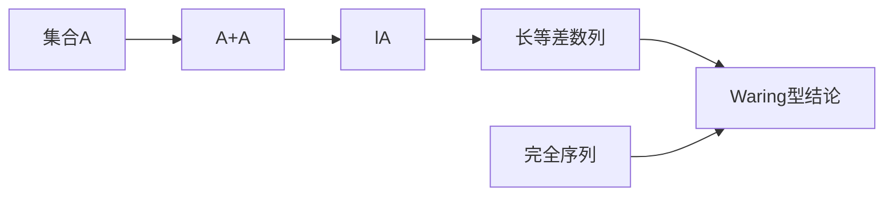

# 第 12 章：和集中的长等差数列

- **难度**：★★★ | **预估学时**：6 小时 | **前置**：第 2、4、10 章

## 学习目标

学完本章，你能：

- 说清"和集比原集合更有结构"这句话的定量含义
- 解释为什么 lA 随 l 增大，越来越像等差数列
- 区分完全序列与次完全序列
- 知道这些结果在 Waring 问题里的用法

## 一句话核心

A+A 一定比 A 更"规整"；重复相加的次数越多，得到的 lA 里包含的等差数列越长，长到只依赖 A 的密度和 l，而不依赖 A 的具体形状。

## 零基础讲解

### 概念 1：和集的"结构增益"

第 4 章已经给出一个结论：若 A 没有明显的傅立叶偏差，则 lA 很快填满整个群。

本章把这个现象量化：即使 A 有偏差，只要 |A| 相对群足够大，lA 里也一定含长等差数列。

**为什么？** 因为加法是"平滑"运算：两个集合相加，重复的表示会被合并，结果是"值域变宽但结构更密"。重复多次，A 的局部不规则性被平均掉，剩下的只有全局的等差结构。

### 概念 2：主要结论的形状

定理大意：若 A ⊂ [1,N] 且 |A| ≥ αN，则对适当的 l，lA 包含长度至少 N^{c(α, l)} 的等差数列。

长度是幂次的，不是对数的。这和 Szemerédi 定理形成对比：Szemerédi 处理的是 A 本身，只能保证长度极短（log 级别）；和集把长度提升到幂次级别。

**代价**：结论说的是 lA，不是 A。lA 比 A 大得多，里面的大部分元素不是 A 的元素。

### 概念 3：完全序列与次完全序列

一个序列 a₁ < a₂ < ... 是完全的，指每个足够大的整数都能表示成若干项之和（每项最多用一次）。次完全序列允许"每个整数都能表示，但项数有界"。

完全性的判定和"部分和序列的密度"有关：如果部分和集合在区间里足够密，就能覆盖所有整数。

**例子**：2 的幂序列是次完全的（二进制表示），但不是完全的（只能表示到某个范围，因为每项最多一次，和有限）。

### 概念 4：证明的骨架

证明分三步：

1. 把 A 的加法结构"摊平"：用傅立叶或者组合方法找一个大的子集 A'，它在某个 GAP 里分布均匀。
2. 在 A' 上构造长等差数列：用 GAP 的坐标把等差数列变成"每个坐标上的等差数列"，再用多维的 Szemerédi 或者直接构造。
3. 把 A' 里的等差数列"提升"回 lA：用多次相加把坐标差补齐。

第三步是技术核心：需要保证补差用的元素仍在 A 里，且用的次数受 l 控制。

### 概念 5：与 Waring 问题的联系

Waring 问题问：每个正整数能否表示成至多 s 个 k 次幂之和。

用和集的语言：令 A 是 k 次幂的集合，问 sA 是否覆盖所有整数。本章的长等差数列结果给出"lA 含长等差数列"，再配合"局部覆盖"和"周期性"论证，可以推出 Waring 型结论。

书里用这套工具重新证明了"薄基"的存在性（第 1 章已经用概率方法给过一次）。

## 图示

## 类比与实例

**类比**：把 A 想成一把沙子，A+A 是把沙子筛一遍，lA 是反复筛。每筛一次，粗细颗粒被分开，剩下的越来越均匀。最后得到的不是原来的沙子，而是一堆"按粒径排好"的沙堆。

**失效边界**：筛沙子会丢失物质，和集不会；类比只能说明"越来越规整"，不能说明"元素变多"。

**实例**：A = {0,1,...,n−1}。A+A = [0,2n−2]，2A+A = [0,3n−3]，kA = [0,kn−k]，本身就是等差数列，长度随 k 线性增长。

再取 A = {0,1,2,4,5,6,...}（去掉 3 的倍数），A+A 里会出现更长的连续段，因为不同的表示把缺口填上了。这就是"结构增益"的最直观例子。

## 常见误解

- 别以为 lA 含长等差数列就意味着 A 也有。lA 大得多，结论不能反推回 A。
- 别以为完全序列等价于"密度大"。完全性是关于"能否表示每个整数"，和密度不是一回事。
- 别以为这套结果只是 Waring 问题的工具。它也是"和集结构"的一般理论，对很多加性问题有用。
- 别以为长度界可以做到线性。幂次界的指数依赖密度和 l，通常很小。

## 自测题（答案）

1. 为什么 lA 比 A 更容易含长等差数列？（答案：多次相加把局部不规则性平均掉，值域变宽且结构更密；解析：重复表示的合并使结果更规整。）
2. 完全序列和次完全序列的区别是什么？（答案：完全序列每项最多用一次就能表示所有足够大的整数，次完全允许有限项数；解析：二进制表示是次完全但不是完全。）
3. 本章结论与 Szemerédi 定理的主要差别是什么？（答案：本章说的是 lA，长度是幂次级；Szemerédi 说的是 A 本身，长度是 log 级；解析：和集提升了结构强度。）

## 复习锚点

- 加法是平滑运算，lA 越大越规整。
- 结论：lA 含幂次长度的等差数列。
- 完全性看"能否表示所有整数"，不看密度。
- Waring 问题是这套工具的直接应用。
