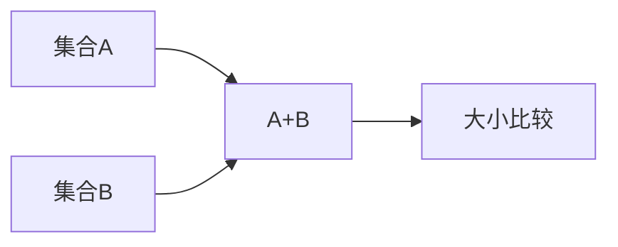

# 加性集与和集

- **难度**：基础 | **涉及章节**：第 0、2 章

## 一句话定义

加性集是一对 (A, Z)：Z 是交换群，A 是 Z 的有限非空子集；和集 A+B 是所有 a+b 的集合。

## 为什么重要

这是全书的原子概念。所有"结构强弱"的判断，最终都落在 |A+B| 与 |A|、|B| 的比较上。

## 图示

## 详解

同一个集合放在不同的环境群里，和集可以完全不同。{1,2,3} 在整数里 A+A 有 5 个元素，在模 3 群里只有 3 个。所以讨论和集必须先说清群。

## 常见误解

别以为 A+B 的大小只由 |A|、|B| 决定。它主要由两者的加法关系决定。

## 在书中出现的脉络

| 章节 | 语境 | 关键结论 |
|---|---|---|
| 第 0 章 | 定义 | 加性集必须带环境群 |
| 第 2 章 | 估计 | |A+B| 小会牵动 |A−B| |
| 第 12 章 | 迭代 | lA 越大越规整 |

## 相关概念

- [倍增常数](c02-倍增常数.md)、[加性能量](c04-加性能量.md)
