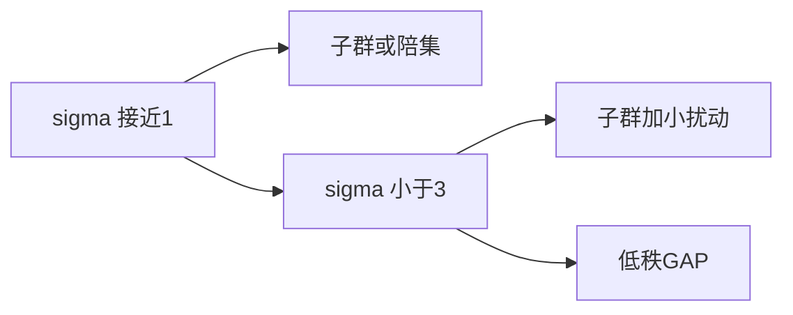

# 倍增常数

- **难度**：基础 | **涉及章节**：第 2、5 章

## 一句话定义

σ[A] = |A+A| / |A|，衡量 A 在加法下膨胀了多少倍。

## 为什么重要

它是全书的结构温度计。σ 接近 1 说明 A 几乎对加法封闭；σ 接近 |A| 说明 A 在加法上接近随机。

## 图示

## 详解

σ 小到什么程度决定能推出什么结构：σ<2 或 <3 时可以完全刻画；σ=O(log|A|) 时靠 Freiman 定理给出 GAP；σ=|A|^ε 时只能给近似子群。

## 常见误解

别以为 σ 小就是等差数列。低秩 GAP、子群加扰动都满足小 σ，形状比等差数列宽。

## 在书中出现的脉络

| 章节 | 语境 | 关键结论 |
|---|---|---|
| 第 2 章 | 定义与估计 | σ 控制各类和集 |
| 第 5 章 | 逆向 | σ 小 ⟹ 低秩结构 |

## 相关概念

- [Ruzsa 距离](c03-Ruzsa距离.md)、[Freiman 同态与 GAP](c07-Freiman同态与GAP.md)
