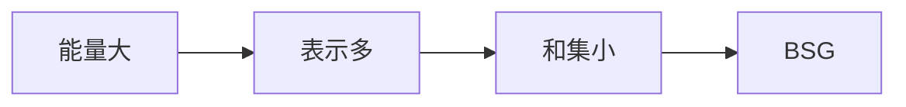

# 加性能量

- **难度**：进阶 | **涉及章节**：第 2、4 章

## 一句话定义

E(A,B) = #{(a,b,a',b') : a+b = a'+b'}，数"同一个和有多少种表示"。

## 为什么重要

能量是"和集小"的定量版本。能量大意味着表示密集，进而意味着存在大子集结构好（BSG）。

## 图示

## 详解

下界 E ≥ |A|²|B|²/|A+B| 由柯西不等式得到。傅立叶形式 E(A,A) = Σ|Â(ξ)|⁴，把能量和谱的集中程度挂钩。

## 常见误解

别以为能量大等于整个集合结构好。BSG 只能保证一个大子集结构好，少数例外元素可以很乱。

## 在书中出现的脉络

| 章节 | 语境 | 关键结论 |
|---|---|---|
| 第 2 章 | 定义 | 能量与和集互为表里 |
| 第 4 章 | 傅立叶 | E = Σ|Â|⁴ |

## 相关概念

- [BSG 定理](c06-BSG定理.md)、[傅立叶系数](c08-傅立叶系数与线性偏差.md)
