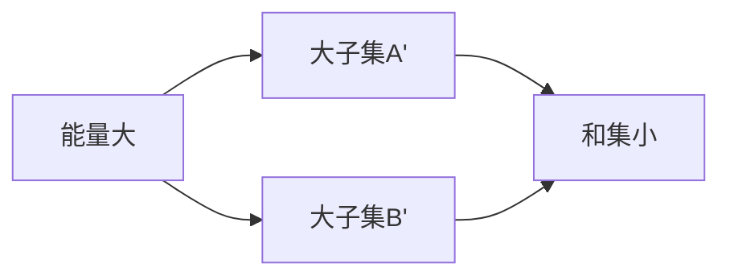

# Balog–Szemerédi–Gowers 定理

- **难度**：高难 | **涉及章节**：第 2、6 章

## 一句话定义

若加性能量接近最大，则存在 A'⊂A、B'⊂B，两者只损失常数因子，且 |A'+B'| 只比 |B'| 大常数倍。

## 为什么重要

它是"能量大 ⟹ 有结构"的转换器，全书使用频率最高的工具之一。

## 图示

## 详解

证明有两条路线：一条用图论（二分图的连通性），一条用依赖随机变量。结论里的"常数倍"依赖初始的 K，通常增长很快。

## 常见误解

别指望它给出整个 A 的结构。它天生要损失子集，这是定理的形式决定的。

## 在书中出现的脉络

| 章节 | 语境 | 关键结论 |
|---|---|---|
| 第 2 章 | 陈述 | 能量转结构 |
| 第 6 章 | 图论证明 | 连通性抽取 |

## 相关概念

- [加性能量](c04-加性能量.md)、Plünnecke 不等式（见第 6 章）
