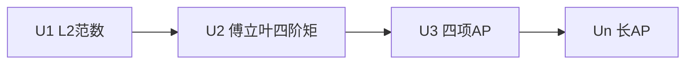

# Gowers 范数

- **难度**：高难 | **涉及章节**：第 11 章

## 一句话定义

U^k 范数是 2^k 个变量上的平均，衡量函数在 k 阶差分结构上是否均匀。

## 为什么重要

k 项等差数列由 U^{k−1} 控制；它把"高阶均匀性"变成一个可计算的量。

## 图示

## 详解

U^1 就是普通 L²；U^2 等价于傅立叶系数的四阶矩；U^3 才能检测 4 项等差数列。逆定理说：范数大 ⟹ 存在低次多项式相位。

## 常见误解

别以为它是傅立叶系数的简单推广。计算复杂度随 k 指数增长。

## 在书中出现的脉络

| 章节 | 语境 | 关键结论 |
|---|---|---|
| 第 11 章 | 定义 | 高阶均匀性 |
| 第 11.4 节 | 逆定理 | 多项式相位 |

## 相关概念

- [傅立叶系数](c08-傅立叶系数与线性偏差.md)、[Szemerédi 定理](c12-正则引理.md)
