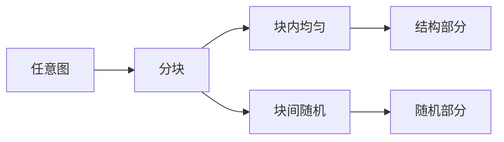

# Szemerédi 正则引理

- **难度**：高难 | **涉及章节**：第 10 章

## 一句话定义

任意大图都可以分成常数多块，使块内边密度近似一致、块间近似随机。

## 为什么重要

它把"任意图"变成"随机图 + 少量例外"，是 Szemerédi 组合证明的核心分解工具。

## 图示

## 详解

分块数量只依赖误差参数 ε，不依赖图的规模。每块大小可以很不均匀，这是"正则"的含义：不是块大小相等，而是边密度规则。

## 常见误解

别以为引理给出的是"等分"。它只保证密度规则，块大小可以差很多。

## 在书中出现的脉络

| 章节 | 语境 | 关键结论 |
|---|---|---|
| 第 10.6 节 | 陈述 | 图的正则分解 |
| 第 10.7 节 | 应用 | Szemerédi 组合论证 |

## 相关概念

- [Gowers 范数](c11-Gowers范数.md)、[Bohr 集](c09-Bohr集.md)
