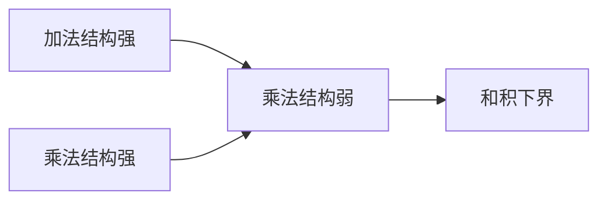

# 和积问题

- **难度**：进阶 | **涉及章节**：第 2、8、9 章

## 一句话定义

问集合 A 的加法和集 |A+A| 与乘法积集 |A·A| 能否同时很小；猜想是不能。

## 为什么重要

它是"加法结构与乘法结构互斥"的定量表达，连接加性组合、几何与代数。

## 图示

## 详解

实数域用关联几何（斜线与双曲线的交点），有限域用组合零点定理或 Stepanov 方法。两条路线的结论形式相似，指数不同。

## 常见误解

别以为和积估计给出了精确值。它只给 max(|A+A|,|A·A|) 的下界，且指数通常很小。

## 在书中出现的脉络

| 章节 | 语境 | 关键结论 |
|---|---|---|
| 第 2.8 节 | 初等估计 | 幂次下界 |
| 第 8.3 节 | 几何证明 | 关联方法 |
| 第 9 章 | 有限域 | 代数方法 |

## 相关概念

- [组合零点定理](c13-组合零点定理.md)、关联几何（见第 8 章）
